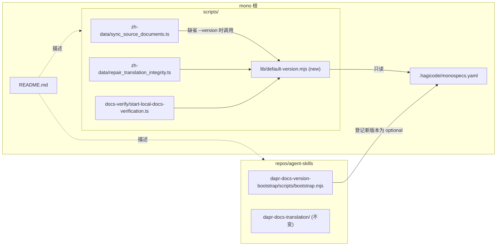
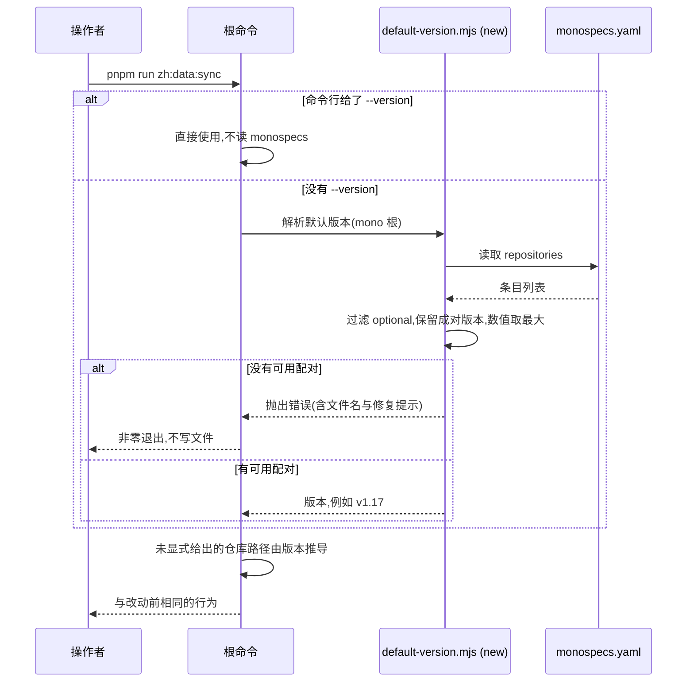

# Design

## Context

动机见 `proposal.md` 的 Why。这里只写会影响做法的现状:

- 三个根命令各自解析参数,风格不同:
  - `sync_source_documents.ts` 用 `util.parseArgs`,默认值写了两遍(`default` 与 `??`)。
  - `repair_translation_integrity.ts` 同样用 `util.parseArgs`,`--repo` 无默认,回退到 `path.join('..', \`${version}_zh\`)`。
  - `start-local-docs-verification.ts` 手写 `argv` 循环;它的 `resolveRepoPaths` 已经按 `version` 派生路径,硬编码只剩 `version: 'v1.17'` 的初值。
- 调用方既有 `.ts`(用 tsx 运行),也有 `.mjs`(`check-zh-data-workspace.mjs` 用 node 运行)。
- `.hagicode/monospecs.yaml` 里 `repos/vX.Y` 与 `repos/vX.Y_zh` 成对登记;当前 `v1.17` 配对为必需,`v1.15` 配对带 `optional: true`。bootstrap 的 `monospecs-edit.mjs` 给新版本写的两条也带 `optional: true`。
- 新增的四个 skill 调用根命令时总是显式传 `--version`、`--source-repo`、`--zh-repo`(verify 的三项检查、incremental 的第 2 步都是如此),所以它们不依赖本 change 的默认值;默认值只服务于人手直接运行。
- `repos/agent-skills` 的测试集中在仓库根的 `tests/` 下,bootstrap 的 plan 测试是 `tests/dapr-docs-version-bootstrap/plan.test.mjs`,已经有对 plan 全文做断言的写法(`FORBIDDEN_IN_PLAN`)。

关于 `--repo` 默认值:任务描述写作 `../_zh` 和 `repos/_zh`,而当前代码实际是 `../<version>_zh`(`../_zh` 只会出现在去掉 `version` 默认值之后)。本设计把它理解为 `repos/<version>_zh`,spec 也按此书写。

## Goals / Non-Goals

**Goals:**
- 三个根命令的默认版本来自同一个地方,换版本时不改脚本。
- 无参数调用在当前工作区的结果与改动前逐字一致。
- 显式参数的优先级清晰且可测试;失败时错误信息能直接指导修复。
- README 与 skill 的实际行为一致,尤其是写入、提交、推送的边界。

**Non-Goals:**
- 不改 `scripts/check-zh-data-workspace.mjs`(它的 `REQUIRED_CHECKOUTS` 仍写死 `repos/v1.17`),也不改 `sync-repos.mjs`。
- 不改 `repos/agent-skills` 中除 `bootstrap.mjs` 一行文案和一个测试文件以外的任何文件,`dapr-docs-translation/` 引擎文件保持原样。
- 不引导、不登记 v1.18,不推送,不创建远端分支。
- 不改变 monospecs 的结构,不为解析器引入新依赖。

## Decisions

### D1:共享解析器用 `.mjs`,放在 `scripts/lib/default-version.mjs`

提供两个出口:
- 解析默认版本:输入 mono 根目录,输出版本字符串,或抛出带固定前缀的错误。
- 由版本推导仓库路径:输出 `repos/<v>` 与 `repos/<v>_zh`。

**为什么是 `.mjs`:** tsx 能引入 `.mjs`,node 也能;`.ts` 的话 `.mjs` 脚本无法引入,以后复用到 `check-zh-data-workspace.mjs` 时还得再改一次。`js-yaml` 已是依赖,`check-zh-data-workspace.mjs` 已经在用它读同一个文件。

**备选:** (a) 在三个脚本里各写一份读取逻辑——违反“单一来源”;(b) 在 `package.json` 里新加一个 `defaultVersion` 字段——又多出一个需要人工同步的地方,而 monospecs 本来就是版本登记处;(c) 写成 `.ts` 并配类型——类型的收益很小,却把 `.mjs` 调用方挡在外面。

### D2:解析规则

1. 读取 `<root>/.hagicode/monospecs.yaml` 的 `repositories`。
2. 只取 `path` 完全匹配 `^repos/v(\d+)\.(\d+)$` 或 `^repos/v(\d+)\.(\d+)_zh$` 的条目,忽略带 `optional: true` 的条目。
3. 只保留“两条都在”的版本配对,按 `(major, minor)` 数值降序,取最大者。
4. 一个配对都没有时,抛出错误:名称包含 `.hagicode/monospecs.yaml`,并提示传 `--version vX.Y`,或登记必需的 `repos/vX.Y` 与 `repos/vX.Y_zh`。文件不存在、YAML 解析失败走同一个错误出口,但原因不同。

**为什么按“非 optional”选:** bootstrap 登记新版本时总是带 `optional: true`(S4 的命令文案就写了),所以引导完成后默认版本不会自己翻到 v1.18;人去掉 `optional: true` 才是“切换默认版本”的显式动作。这与 `check-zh-data-workspace.mjs` 已有的约定一致(必需条目不能是 optional)。

**为什么按数值比较:** 字符串比较会让 `v1.9` 排到 `v1.17` 之后。

### D3:显式 `--version` 不读 monospecs;解析只在缺省时发生

- 命令行没给 `--version` 才调用解析器。这样 monospecs 损坏时,显式传版本的调用(包括四个 skill 的所有调用)不受影响。
- 仓库路径的优先级:显式的 `--source-repo`/`--zh-repo`/`--repo` > 由版本推导。推导出的值形如 `repos/v1.17`,与改动前的字面默认值完全相同,所以后续对它的使用(`resolve`、`join(...,'hugo.yaml')`、输出信息)都不变。
- `sync` 的 `--hugo-config` 默认值依赖最终的 `source-repo`,必须在版本和仓库路径确定之后再计算。

**备选:** 把解析放进 `parseArgs` 的 `default` 回调——`util.parseArgs` 的 `default` 是静态值,做不到惰性读取,而且会让显式传参也触发读文件。

### D4:解析器读取 monospecs 的根目录

- `docs:verify`:用它已有的 `--workspace-root`(默认是脚本所在位置推出的 mono 根)。
- `sync`、`repair`:用 mono 根,由共享模块自身的位置推出(`scripts/lib/` 的上两级)。

**为什么不用 `process.cwd()`:** 从子目录运行 pnpm 时,pnpm 会把 cwd 设成包根,但直接 `tsx` 调用不会,按脚本位置定根更稳。推导出的仓库路径仍是相对路径(与改动前一致,由使用处按 cwd 解析),所以对从 mono 根运行的人没有可见变化。

### D5:`zh:data:repair` 的 `--repo` 默认值

默认值为 `repos/<version>_zh`,和 `sync` 的默认风格一致(相对路径,由 `path.resolve` 在使用处解析)。显式 `--repo` 的行为不变。README 里“从 mono 根运行时要传 `--repo repos/v1.17_zh`”的提示随之删除。

### D6:让解析可测试的最小重构

- `sync_source_documents.ts` 里的 `parseCliArgs` 与 `start-local-docs-verification.ts` 里的 `parseArgs` 不能直接被测试(后者在导入时就会执行 `main`)。
- 做法:把参数解析导出为接受 `argv` 的纯函数,并让 `start-local-docs-verification.ts` 采用 `sync_source_documents.ts` 已有的“仅当作为入口运行时才执行 `main`”的写法。
- 测试放在已有的测试文件里,使用临时工作区和临时 monospecs,不依赖真实 `repos/`:
  - 解析器单测放在新文件 `scripts/tests/default-version.test.mjs`,通过 `package.json` 的一个新 test 脚本运行(不并入现有的四个验收命令)。
  - sync 与 repair 的默认值、优先级放进 `zh:data:test` 的测试文件;docs-verify 的放进 `docs:verify:test` 的测试文件。
  - “无参数、v1.17 默认行为不变”的测试直接读真实的 monospecs 不可靠(它会随版本登记变化),所以用固定的临时 monospecs 复现当前形态:v1.17 必需、v1.15 optional。

### D7:README 的组织方式

- “Translate with the skill”分成三小节:引擎(现有的 `tr.mjs` 循环)、四个 skill 的顺序与入口(一张表:skill、入口命令、默认行为、确认规则)、写入与推送边界(分条列出引擎、incremental、verify、bootstrap、upstream-pr 各自能做什么)。
- “Upstream pull requests through fork-docs”改为:先说明要先有 verify 的通过结论;再按 `dapr-docs-upstream-pr` 的 A、B 两阶段列出,最后保留四步手动等价命令(快进、切子模块、构建、提交推送建 PR)。fork-docs 自己的 README 没有这个流程,所以文中不引用它。
- 命令说明改为:默认版本来自 monospecs 的必需配对,显式 `--version` 优先;`docs:verify` 的默认端口等不变的默认值保留。
- 内容以各 skill 的 `SKILL.md` 为准,README 只写入口和规则,不复制步骤表,避免漂移。

### D8:`.hagicode/monospecs.yaml` 只改一条 `note`

`repos/agent-skills` 的 `note` 改为列出五个 skill:`dapr-docs-translation`、`dapr-docs-translate-incremental`、`dapr-docs-translation-verify`、`dapr-docs-version-bootstrap`、`dapr-docs-upstream-pr`。其他条目、`optional` 标记、版本配对一概不动;不加 `repos/v1.18`、`repos/v1.18_zh`。

### D9:bootstrap S4 文案修复

- `bootstrap.mjs` 里 S4 的步骤标题改为插入 `V`:`register repos/${V} and repos/${V}_zh in monospecs`(`V` 已经是 `v1.18` 这种形式)。
- 在 `plan.test.mjs` 对 plan 全文做两条断言:不含字面 `repos/V `,也不含 `repos/V_zh`。后者是为了避免只改了一半也能通过。
- 步骤编号、完成判定、命令列表都不变,因此计划哈希里与步骤标题无关的部分不变。若标题参与哈希,已有的确认值会因此失效——这是预期的:本 change 不执行任何引导,没有未完成的确认。

### D10:这次不触碰 `check-zh-data-workspace.mjs`

验收只要求它仍报告 ready,而它的必需条目检查对 v1.17 是成立的。若把它也接到解析器上,它的测试夹具(只登记 v1.17)要一起改,超出本次范围。记为后续可做。

## 架构

*说明:三个命令只通过共享模块读取 monospecs;bootstrap 写入的 optional 条目不会被解析器选中;`dapr-docs-translation/` 不参与本次改动。支撑 D1、D2 与 D10。*

## 解析流程

*说明:显式 `--version` 不读 monospecs;没有可用版本时命令在写任何文件之前失败。支撑 D2、D3。*

## 代码改动清单

| File Path | Change Type | Change Description | Affected Module |
|-----------|-------------|-------------------|-----------------|
| `scripts/lib/default-version.mjs` | 新增 | 解析默认版本、推导仓库路径、统一错误信息 | 解析器 |
| `scripts/tests/default-version.test.mjs` | 新增 | 覆盖数值比较、optional 与不成对被忽略、文件缺失、YAML 损坏、无可用配对 | 解析器 |
| `package.json` | 修改 | 增加解析器单测的 test 脚本;不改现有脚本 | npm scripts |
| `scripts/zh-data/sync_source_documents.ts` | 修改 | 删除三处 `v1.17` 字面量;版本缺省时调用解析器;先定版本与仓库路径,再算 `hugo-config`;参数解析导出供测试 | `zh:data:sync` |
| `scripts/zh-data/repair_translation_integrity.ts` | 修改 | 删除 `version` 字面默认;`repo` 默认改为 `repos/<version>_zh` | `zh:data:repair` |
| `scripts/docs-verify/start-local-docs-verification.ts` | 修改 | `version` 初值改为缺省时调用解析器(根为 `--workspace-root`);仅作为入口运行时才执行 `main`;导出参数解析 | `docs:verify` |
| `scripts/zh-data/tests/test_sync_source_documents.ts` | 修改 | 增加 sync 与 repair 的默认值、显式优先、v1.17 不变的用例 | `zh:data:test` |
| `scripts/docs-verify/tests/validate-local-docs-verification.ts` | 修改 | 增加无 `--version` 的解析结果、显式优先、无可用版本报错的用例 | `docs:verify:test` |
| `README.md` | 修改 | 见 D7 | 根文档 |
| `.hagicode/monospecs.yaml` | 修改 | 仅 `repos/agent-skills` 的 `note` | 仓库登记 |
| `repos/agent-skills/dapr-docs-version-bootstrap/scripts/bootstrap.mjs` | 修改 | S4 标题插入具体版本 | bootstrap plan |
| `repos/agent-skills/tests/dapr-docs-version-bootstrap/plan.test.mjs` | 修改 | 增加两条占位符断言 | agent-skills 测试 |

## 需求到任务的追踪

```mermaid
flowchart LR
    subgraph SPEC["Requirements"]
        R1["默认版本来自 monospecs"]
        R2["显式版本优先并推导仓库"]
        R3["repair 默认仓库在 mono 根内"]
        R4["无可用版本给出明确错误"]
        R5["docs:verify 输出不变"]
        R6["默认版本只有一个来源"]
        R7["README 的角色、顺序、边界、fork 流程"]
    end
    subgraph DEC["Decisions"]
        D1["D1 与 D2 解析器"]
        D3["D3 显式优先"]
        D5["D5 repair 默认值"]
        D6["D6 可测试性"]
        D7["D7 与 D8 文档与登记"]
        D9["D9 S4 文案"]
    end
    subgraph TASK["Tasks"]
        T1["1 共享解析器"]
        T2["2 zh:data:sync"]
        T3["3 zh:data:repair"]
        T4["4 docs:verify"]
        T5["5 README"]
        T6["6 monospecs note"]
        T7["7 bootstrap S4"]
        T8["8 验收"]
    end
    R1 --> D1 --> T1
    R4 --> D1
    R2 --> D3 --> T2
    D3 --> T4
    R3 --> D5 --> T3
    R5 --> D6 --> T4
    R6 --> D1
    D6 --> T8
    R7 --> D7 --> T5
    D7 --> T6
    D9 --> T7
    T2 --> T8
    T3 --> T8
```

*说明:每条需求都落到某个决定和某个任务;S4 文案修复不是 spec 层面的需求,只通过 D9 到 T7。支撑任务拆分。*

## Risks / Trade-offs

- **[README 与 skill 行为漂移]** → README 只写入口与规则,不复制步骤表;任务里要求对照四个 `SKILL.md` 逐项核对,并链接到各 skill。
- **[默认版本翻转令人意外]** → 翻转只发生在有人把某个版本的两条登记都改为必需时;README 写明这一规则,spec 里有“bootstrap 登记不会改变默认值”的场景。
- **[测试依赖真实 monospecs]** → 所有“默认值”测试用临时 monospecs,不读真实文件;验收里“当前工作区仍是 v1.17”由命令级验收(`zh:data:check`、`docs:verify` 加 `--dry-run`)覆盖。
- **[导出解析函数改变了入口脚本的形状]** → 只改成“仅作为入口运行时才执行 `main`”,`sync_source_documents.ts` 本来就是这个写法;`docs:verify` 的对外行为(参数、输出、退出码)不变,由 `--dry-run` 对比验证。
- **[解析器多一次读文件]** → 只在缺省 `--version` 时发生,开销可以忽略。
- **[`check-zh-data-workspace.mjs` 仍写死 v1.17]** → 记为已知项。它在默认版本改变前一直是正确的;默认版本变化时,这个检查需要同步改动,应当在 README 里提一句。

## Migration Plan

- 无数据迁移,无配置迁移。现有的无参数与显式参数调用结果不变,`.hagicode/monospecs.yaml` 除一条 `note` 外不变。
- 回滚:恢复上述文件即可,没有产生需要清理的状态。
- 本 change 不执行任何引导或推送,所以不存在需要人工善后的外部状态。

## Open Questions

- 当 `check-zh-data-workspace.mjs` 也接入解析器时,它的 `OPTIONAL_CHECKOUTS` 是否也应由 monospecs 推导?这个问题不影响本 change 的 spec、做法或任务,可以留到后续。
