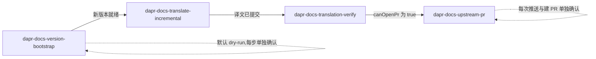

# Proposal

## Why

上一个 change(已归档的 `dapr-docs-translation-orchestration-skills`)在 `repos/agent-skills` 里新增了四个 skill:`dapr-docs-version-bootstrap`、`dapr-docs-translate-incremental`、`dapr-docs-translation-verify`、`dapr-docs-upstream-pr`。mono 根还停在只有一个翻译引擎的时代:`zh:data:sync`、`zh:data:repair`、`docs:verify` 把 `v1.17` 写死在各自的脚本里,README 也没有说明这四个 skill 的顺序、入口和确认规则,还保留了与现状不符的“skill 从不推送”。一旦 `v1.18` 引导完成,这些硬编码默认值和过时文档会同时失效,所以现在需要先把 mono 根调整到位。

## What Changes

- **默认版本只有一个来源。** 新增一个小型共享模块,在没有 `--version` 时,从 `.hagicode/monospecs.yaml` 读取“最新的、非 optional 的 `vX.Y` 与 `vX.Y_zh` 配对”作为默认版本。各脚本不再写 `'v1.17'`、`repos/v1.17`、`repos/v1.17_zh` 字面量。
  - 显式 `--version` 永远优先,并且此时不读取 monospecs;`--source-repo`、`--zh-repo`(以及 `--repo`)在没有显式给出时,由版本推导为 `repos/<version>`、`repos/<version>_zh`。
  - 无参数的 `pnpm run zh:data:sync` 在当前工作区仍然解析为 v1.17,行为不变。
  - monospecs 里找不到可用版本时,命令给出明确错误并以非零退出,不写任何文件。
- **修正 `zh:data:repair` 的 `--repo` 默认值。** 现在的代码是 `path.join('..', \`${version}_zh\`)`,从 mono 根运行会解析到仓库之外;改为相对 mono 根的 `repos/<version>_zh`。
- **更新根 `README.md`。** 重写“Translate with the skill”“Upstream pull requests through fork-docs”和仓库角色表;写明四个 skill 的顺序 `bootstrap -> translate-incremental -> verify -> upstream-pr`、各自入口命令、默认 dry-run 与逐步确认规则;用准确的表述取代“The skill writes only `translations/` and `translated_content/`, and it never pushes”,区分翻译引擎与新增 skill;更新 `zh:data:*` 与 `docs:verify` 的默认值说明。
- **更新 `.hagicode/monospecs.yaml` 中 `repos/agent-skills` 的 `note`**,列出五个 skill。不登记 `repos/v1.18`、`repos/v1.18_zh`,登记是 bootstrap skill 在人工确认之后才做的一步。
- **OpenSpec:** 对现有 spec `zh-translation-skill-workspace` 写 delta,调整“Roles of the listed repositories are documented”和“Fork pull-request procedure is documented”;新增能力 `root-command-version-resolution`。
- **修复 `repos/agent-skills` 的一个小缺陷。** `dapr-docs-version-bootstrap/scripts/bootstrap.mjs` 的 S4 步骤文案打印字面占位符 `register repos/V and repos/V_zh in monospecs`,改为具体的 `repos/vX.Y` 形式,并在 `tests/dapr-docs-version-bootstrap/plan.test.mjs` 增加断言。`dapr-docs-translation/` 引擎文件保持不变。

本 change 不执行任何新版本引导(包括针对 v1.18 的 `bootstrap.mjs apply`),不推送,不创建远端分支。没有 **BREAKING** 变更:无参数调用的结果与改动前一致。

*说明:README 将按此顺序记录四个 skill;只有最前和最后的 skill 带有公开推送动作,且都需要单独确认。支撑“更新根 README.md”。*

## Involved Repositories

No confirmed repository scope is specified for this change.

下表列出的是本 change 预计触及的文件;文件所在位置本身不构成对任何仓库权限的声明。

### 代码改动表

| File Path | Change Type | Change Reason | Impact Scope |
|-----------|-------------|---------------|--------------|
| `scripts/lib/default-version.mjs` | 新增 | 默认版本的唯一来源,同时可被 tsx 与 node 引入 | 三个根命令 |
| `scripts/zh-data/sync_source_documents.ts` | 修改 | 去掉 `v1.17` 默认值,版本解析后再推导仓库路径与 `hugo.yaml` | `zh:data:sync` |
| `scripts/zh-data/repair_translation_integrity.ts` | 修改 | 去掉 `v1.17` 默认值,`--repo` 默认改为 `repos/<version>_zh` | `zh:data:repair` |
| `scripts/docs-verify/start-local-docs-verification.ts` | 修改 | `version` 初值改为解析器结果(显式参数优先) | `docs:verify` |
| `scripts/tests/default-version.test.mjs` | 新增 | 解析器单测:优先级、数值比较、optional 与配对、错误信息 | 解析器 |
| `scripts/zh-data/tests/test_sync_source_documents.ts` | 修改 | 覆盖 sync 与 repair 的默认值与显式参数优先 | `zh:data:test` |
| `scripts/docs-verify/tests/validate-local-docs-verification.ts` | 修改 | 覆盖无 `--version` 时的解析结果、显式参数优先、无可用版本时报错 | `docs:verify:test` |
| `package.json` | 修改 | 为解析器单测增加一个 test 脚本 | npm scripts |
| `README.md` | 修改 | 四个 skill 的顺序与规则、角色表、fork 流程、默认值说明 | 根文档 |
| `.hagicode/monospecs.yaml` | 修改 | 仅改 `repos/agent-skills` 的 `note` | 仓库登记 |
| `openspec/changes/adapt-mono-to-new-dapr-docs-translation-skills/specs/**` | 新增 | delta 与新能力 spec | OpenSpec |
| `repos/agent-skills/dapr-docs-version-bootstrap/scripts/bootstrap.mjs` | 修改 | S4 文案改为具体的 `repos/vX.Y` | bootstrap 的 plan 输出 |
| `repos/agent-skills/tests/dapr-docs-version-bootstrap/plan.test.mjs` | 修改 | 断言 plan 输出不含字面占位符 | agent-skills 测试 |

## Capabilities

### New Capabilities
- `root-command-version-resolution`: 根命令 `zh:data:sync`、`zh:data:repair`、`docs:verify` 如何确定目标版本及其仓库路径:显式 `--version` 优先、默认版本来自 monospecs、optional 条目与不成对条目被忽略、无可用版本时的明确错误,以及 `zh:data:repair` 的 `--repo` 默认值。

### Modified Capabilities
- `zh-translation-skill-workspace`: 调整“Roles of the listed repositories are documented”(角色表要涵盖四个新 skill,区分引擎与 skill 的写入与推送边界)和“Fork pull-request procedure is documented”(上游 PR 流程由 `dapr-docs-upstream-pr` 的两阶段确认定义,README 同时保留手动等价步骤)。

## Impact

- **代码:** 三个根命令脚本、一个新增共享模块、相关测试、`package.json` 的一个 test 脚本;`repos/agent-skills` 中仅 `bootstrap.mjs` 一行文案和一个测试文件。
- **文档与配置:** 根 `README.md`、`.hagicode/monospecs.yaml` 的一条 `note`。
- **依赖:** 不新增依赖,`js-yaml` 已在 `package.json` 中。
- **范围外(已知):** `scripts/check-zh-data-workspace.mjs` 的 `REQUIRED_CHECKOUTS` 仍写死 `repos/v1.17`。验收要求只是 `zh:data:check` 在当前工作区仍报告 ready,所以本 change 不改它;后续可复用同一个解析器。
- **验收:**
  - `pnpm run zh:data:test`、`pnpm run docs:verify:test`、`pnpm run zh:data:check:test`、`pnpm run sync:repos:test` 全部通过。
  - `pnpm run zh:data:check` 在当前工作区仍报告 ready。
  - `pnpm run docs:verify` 加 `--dry-run`(沿用仓库既有的参数传递方式,即参数直接跟在脚本名之后)的解析结果与改动前完全一致。
  - 在 `repos/agent-skills` 中 `npm test` 通过,且 `dapr-docs-translation/` 引擎文件没有改动。
  - 没有执行新版本引导,没有推送,没有创建远端分支,`repos/v1.18` 与 `repos/v1.18_zh` 仍未登记。
