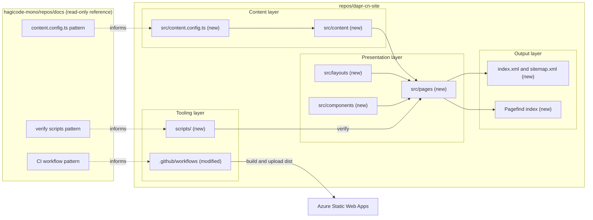
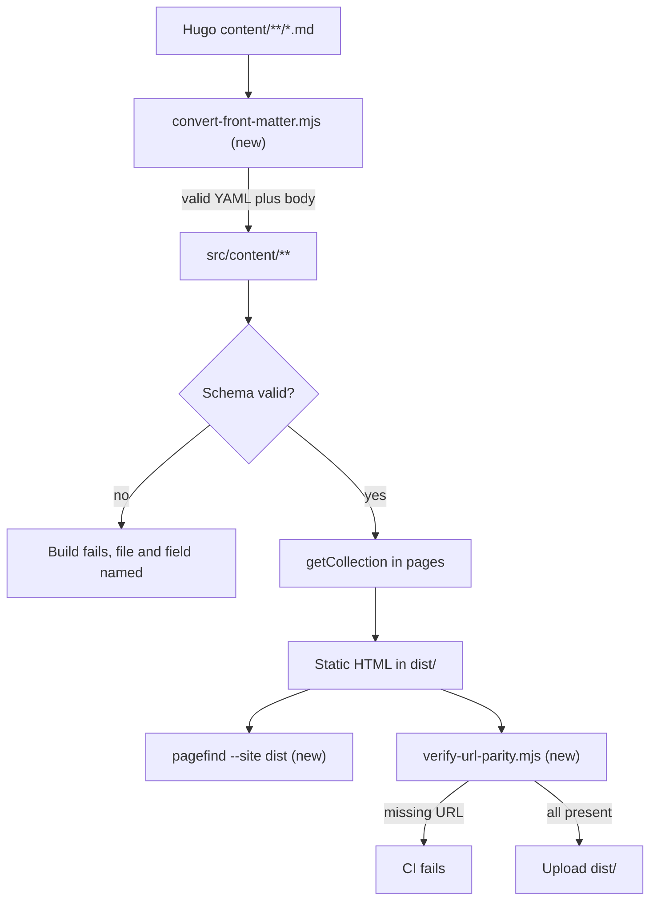
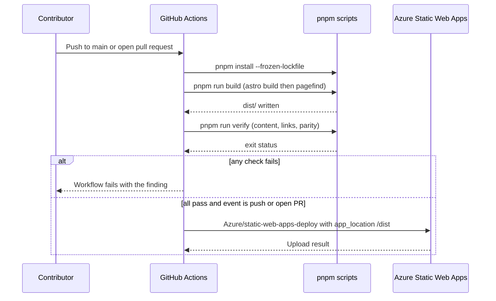
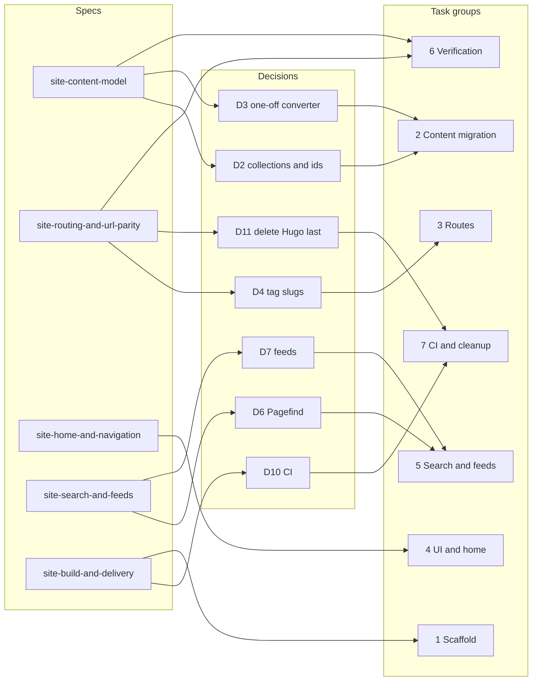

# Design

## Context

See `proposal.md` for motivation and scope. Constraints that shape the approach:

- `repos/dapr-cn-site` is a Hugo 0.97.3 site that pulls the Wowchemy theme through Go modules (`go.mod` replaces it with the `dapr-cn/wowchemy-hugo-themes` fork). There is no local `layouts/`, so there is no template code to port. Every page is produced by the theme from content plus `config/_default/*.yaml`.
- Content: 61 markdown files (46 YAML, 9 TOML, 6 without front matter), 15 posts, 5 events, 5 publications, 11 authors, about 37 MB including images. Posts, events and publications are page bundles (`index.md` plus `images/` or `featured.*`). Authors are `authors/<id>/_index.md` plus an avatar.
- Hugo behaviour the site relies on: `defaultContentLanguage: zh`, `removePathAccents`, permalinks for `/author/:slug/`, `/tag/:slug/`, `/category/:slug/`, RSS on home and sections, `enableRobotsTXT`, built-in search, Google Analytics `G-J4DYYVC8KL`.
- Deployment: `.github/workflows/release.yml` builds with Hugo and uploads `public/` to Azure Static Web Apps with `skip_app_build: true`. `hugo-build.yml` is a PR build test. `netlify.toml` is a leftover.
- `/source` and `/case` are navigation targets backed by the separate repos `dapr-cn-site-source` and `dapr-cn-site-case` (both Hugo, `baseURL = "/"`, no workflows in those repos). How they are published under `cn.dapr.io` is not visible from this repository.
- Reference: `hagicode-mono/repos/docs` (Astro 7, Starlight 0.42, pnpm, typed `content.config.ts` with a custom `generateId`, `verify:*` scripts, Node 24 CI). `hagicode-mono/repos/hagitask-site` shows a non-Starlight Astro site. Both are read-only.

## Goals / Non-Goals

**Goals:**
- A plain Astro site at the repository root that reproduces every public page and URL of the Hugo site.
- Content validated by one schema, with failures that point at the file.
- A build that needs only Node and pnpm, and verification scripts that run in CI.
- A migration order in which Hugo is deleted only after parity is proven.

**Non-Goals:**
- Pixel-level reproduction of the Wowchemy "1950s" theme.
- Editing article prose or fixing the 7 hotlinked `wework.qpic.cn` images.
- Rebuilding `/source` and `/case`, adding comments, or adding languages.
- Adopting Starlight, a docs sidebar or HagiCode's i18n and hagilight packages.

## Architecture

*Caption: all new code lives in `repos/dapr-cn-site`; the reference project informs patterns only and nothing flows back to it. Supports the Decisions section.*

## Decisions

### D1. Plain Astro with content collections, not Starlight or a theme

Starlight owns the page chrome (sidebar, docs routing, locale handling), which the home page, event list and publication list would fight. A community Astro theme would add an upstream to track and still lose the Wowchemy look. Plain Astro keeps full control and costs one layout, a header, a footer and seven home sections.

*Alternatives:* Starlight + `starlight-blog` (what HagiCode docs use), a third-party theme. Both rejected for the reasons above.

### D2. Collections keyed by folder name, with an explicit `generateId`

Astro's glob loader slugifies ids from paths, which could change URLs. Following `repos/docs/src/content.config.ts`, each collection uses `generateId` to return the folder name (`202306-dapr-release-111`), so the route `/post/[id]/` equals the Hugo slug. Patterns: `post/*/index.md`, `event/*/index.md`, `publication/*/index.md`, `authors/*/_index.md` (renamed to `index.md` during migration so the loader skips no files). Page bundles stay as folders so relative image links keep working and Astro's image pipeline optimises them.

Schemas (shape, not code):
- `post`: `title`, `date`, `authors[]`, `tags[]` (default `[]`, empty strings removed), `summary`, `abstract?`, `featured` (default false), `draft` (default false), `header.image?`.
- `event`: `title`, `date`, `date_end?`, `location?`, `event_url?`, `summary`, `tags[]`, `featured`, `publishDate?`, `image?`.
- `publication`: `title`, `date`, `publication_types[]`, `publication`, `publication_short?`, `abstract`, `tags[]`, `links[]`, `featured`.
- `authors`: `title`, `role`, `bio`, `organizations[]`, `interests[]`, `social[]`, `avatar`.

*Alternative:* keep Hugo's `_index.md` names and customise the pattern. Rejected: the rename is mechanical and simpler to reason about.

### D3. One-off converter, committed output

`scripts/convert-front-matter.mjs` reads each Hugo file, parses TOML (`+++`) or YAML (`---`), supplies a title for files with none, writes YAML front matter and leaves the body untouched, and writes the result under `src/content/`. Output is committed, and the script is kept until the migration is verified, then removable. Rationale: a conversion that runs once is easier to review as a diff than as a loader parser that runs on every build, and every file then matches the schema with no special cases.

*Alternative:* a custom loader that parses TOML at build time. Rejected: it leaves two formats in the repository forever.

### D4. Tag URLs reproduce Hugo's `urlize`

Hugo lower-cases tags, replaces spaces with `-`, and keeps CJK characters. `tagSlug()` does the same, so `/tag/翻译/` and `/tag/name-resolution/` match. The tag page is generated with `getStaticPaths`; a request using the percent-encoded form resolves to the same directory. The parity script covers CJK explicitly, because this is the part most likely to differ. Empty-string tags (`tags: [""]` appears in 3 files) are stripped in the schema transform.

### D5. Events split by date at build time

Hugo's `publishDate` hides future pages. All current events are past, so the schema keeps `publishDate` only for ordering, and the home page computes upcoming versus review from `date` at build time. The consequence is that a future event becomes "past" only after the next build; see Risks.

### D6. Search is Pagefind run after the build

HagiCode docs get Pagefind through Starlight. A plain Astro site runs `pagefind --site dist` as a `postbuild` step and loads the generated UI in a header dialog. Article bodies carry `data-pagefind-body`; list and chrome pages do not, which keeps the index to real content. Pagefind segments CJK text, which must be confirmed on real content (see the search task). No external service or key is needed.

*Alternatives:* Algolia (needs account and keys), dropping search (loses an existing feature).

### D7. Feeds and sitemap are Astro endpoints at the Hugo URLs

`src/pages/index.xml.ts` (using `@astrojs/rss`) serves posts at `/index.xml`, matching Hugo's home RSS. `src/pages/sitemap.xml.ts` builds the sitemap from the collections at `/sitemap.xml`. Using endpoints instead of `@astrojs/sitemap` keeps the Hugo path (the integration emits `/sitemap-index.xml`) and removes a dependency and a redirect file. `public/robots.txt` points to `https://cn.dapr.io/sitemap.xml`. Hugo's JSON index, web manifest and `headers`/`redirects` outputs are dropped: nothing in the repository consumes them, and search moves to Pagefind. See Open Questions for the one assumption here.

### D8. Theme by CSS variables and a pre-paint script

Colours are tokens on `:root`, overridden under `:root[data-theme="dark"]` and, when no choice is stored, under `prefers-color-scheme: dark`. A small inline script in `<head>` applies the stored choice before first paint, so there is no flash. The toggle writes the choice to `localStorage`, guarded by try/catch because storage can be unavailable. This is the only mandatory client script besides search.

### D9. Styling is hand-written CSS in Astro components

The site has about a dozen components. A utility framework or UI kit would be heavier than the problem. Scoped component CSS plus one tokens file is enough, and it keeps the build dependency list short.

### D10. CI mirrors HagiCode's `docs-ci.yml`, keeps the Azure upload

Both workflows switch from Go and Hugo to Node 24 with pnpm (`corepack`, version from `packageManager`). `release.yml` builds, runs the verify scripts, reports the `dist/` size and passes `app_location: "/dist"` with `skip_app_build: true` to the unchanged `Azure/static-web-apps-deploy` step. `hugo-build.yml` becomes the same build and checks without upload. Their triggers stay as they are.

### D11. Hugo is deleted last

Deletion of `go.mod`, `config/`, `theme.toml` and the rest happens only after the parity script reports no missing Hugo URL. Until then the repository holds both. This gives the migration a safe stopping point and a clean rollback.

## Data flow

*Caption: content is converted once, validated on every build, and only reaches the upload when the route parity check passes. Supports the Decisions section (D2, D3, D11).*

## Build and CI sequence

*Caption: the upload step is reached only after build and verification succeed, and still runs against the prebuilt `dist/` with the remote build skipped. Supports Decision D10.*

## Detailed code change inventory

All paths are relative to `repos/dapr-cn-site/`.

| File Path | Change Type | Change Description | Affected Module |
|-----------|-------------|-------------------|-----------------|
| `package.json` | Add | Scripts `dev`, `build`, `postbuild` (pagefind), `preview`, `verify`; `packageManager`; deps `astro`, `@astrojs/rss`, `sharp`; dev deps `pagefind`, `@iarna/toml` (or equivalent) | Build |
| `pnpm-lock.yaml`, `pnpm-workspace.yaml` | Add | Lockfile and build-script allow-list for `sharp` | Build |
| `tsconfig.json` | Add | Astro strict preset, `@/*` alias | Build |
| `astro.config.mjs` | Add | `site`, `trailingSlash: 'always'`, `build.format: 'directory'`, markdown config | Build |
| `src/content.config.ts` | Add | Four collections, `generateId`, `tag` transform, author reference check | Content model |
| `src/content/post/*/index.md` + images | Move + modify | From `content/post/*`; YAML front matter; body unchanged | Content |
| `src/content/event/*/index.md` + images | Move + modify | From `content/event/*`; `_index.md` section page dropped | Content |
| `src/content/publication/*/index.md` + images | Move + modify | From `content/publication/*` | Content |
| `src/content/authors/*/index.md` + avatars | Move + modify | From `content/authors/*/_index.md` | Content |
| `src/content/pages/{tour,people,meeting,translation}.md` | Move + modify | Static pages as a fifth collection `pages`; `translation/docs` image folder moves with it | Content |
| `src/config/site.ts` | Add | Title, description, base URL, GA id, copyright, GitHub URL | Site |
| `src/config/nav.ts` | Add | The nine entries from `menus.yaml` with their URLs | Navigation |
| `src/lib/tags.ts` | Add | `tagSlug()` equal to Hugo `urlize`; tag index and counts | Routing |
| `src/lib/events.ts` | Add | Split into upcoming and past by date | Home |
| `src/layouts/BaseLayout.astro` | Add | Head metadata, canonical, RSS link, GA on production, pre-paint theme script | Layout |
| `src/layouts/ArticleLayout.astro` | Add | Title, date, authors, tags, body, `data-pagefind-body` | Layout |
| `src/components/Header.astro`, `Footer.astro`, `ThemeToggle.astro`, `Search.astro` | Add | Navigation, copyright, theme switch, Pagefind dialog | UI |
| `src/components/home/{Hero,Activities,EventList,PostGrid,PostList,TagCloud}.astro` | Add | The seven home sections (events are one component used twice) | UI |
| `src/components/{PostCard,EventCard,PublicationCard,AuthorBadge}.astro` | Add | Cards used by list and home pages | UI |
| `src/styles/tokens.css`, `global.css` | Add | Light and dark tokens, typography, layout | UI |
| `src/pages/index.astro` | Add | Home | Routing |
| `src/pages/post/index.astro`, `post/[id].astro` | Add | Post list and detail | Routing |
| `src/pages/event/index.astro`, `event/[id].astro` | Add | Event list and detail | Routing |
| `src/pages/publication/index.astro`, `publication/[id].astro` | Add | Publication list and detail | Routing |
| `src/pages/author/[id].astro`, `tag/[tag].astro` | Add | Author and tag archives | Routing |
| `src/pages/[page].astro` or four pages | Add | `/tour/`, `/people/`, `/meeting/`, `/translation/` | Routing |
| `src/pages/index.xml.ts`, `sitemap.xml.ts`, `404.astro` | Add | RSS, sitemap, not-found page | Feeds |
| `public/robots.txt`, `public/favicon.*`, `public/media/**` | Add | Moved from `static/` and `assets/media/` (logo, icon, slider images) | Assets |
| `scripts/convert-front-matter.mjs` | Add | One-off conversion described in D3 | Migration |
| `scripts/verify-content.mjs` | Add | Front matter, author references, local images, internal links | Verification |
| `scripts/verify-url-parity.mjs` | Add | Compare `dist/` routes with the recorded Hugo URL list (`scripts/hugo-urls.txt`) | Verification |
| `scripts/hugo-urls.txt` | Add | Snapshot of the Hugo sitemap URLs taken before deletion | Verification |
| `.github/workflows/release.yml`, `hugo-build.yml` | Modify | Node 24, pnpm, `dist/`, verify steps; Azure step unchanged apart from `app_location` | CI |
| `.gitignore` | Modify | Add `dist/`, `.astro/`, `node_modules/`; drop Hugo entries | Tooling |
| `.devcontainer/**`, `.gitpod.yml`, `.vscode/settings.json` | Modify | Node and pnpm environment, port 4321 | Tooling |
| `README.md` | Modify | Replace "TBD" with install, dev, build, verify, content authoring | Docs |
| `go.mod`, `go.sum`, `theme.toml`, `netlify.toml`, `HUGO_VERSION.md`, `preview.png`, `config/**` | Delete | Hugo and theme leftovers | Repo hygiene |
| `content/**`, `assets/**`, `static/**` | Delete | After move to `src/content` and `public` | Repo hygiene |

## Requirement-to-task traceability

*Caption: every spec reaches a decision or a task group, and the parity and content requirements converge on the verification group. Supports the Decisions section.*

## Risks / Trade-offs

- **[URL regressions on the live site]** → The parity script compares `dist/` with a snapshot of the Hugo sitemap, and CI fails on a missing URL. The snapshot is taken before any Hugo file is deleted.
- **[CJK tag paths differ from Hugo]** → `tagSlug()` mirrors `urlize`; the parity snapshot includes the tag URLs; one task checks both the literal and the percent-encoded request.
- **[Pagefind index quality for Chinese]** → Check real queries ("服务调用", "翻译") against the built index; if segmentation is poor, fall back to a documented limitation rather than adding a service.
- **[Event sections go stale between builds]** → Accept for now, since the current events are all past; a scheduled rebuild is a later concern and not part of this change.
- **[Visual redesign surprises maintainers]** → Declared as BREAKING in the proposal; structure and content stay identical, so the redesign can iterate without further migration.
- **[Large images slow the build]** → `sharp` processing of about 37 MB is cheap; the CI size report will show any growth.
- **[Hotlinked `wework.qpic.cn` images may disappear]** → Out of scope; the content check lists external images so they are visible.
- **[`/source` and `/case` become unreachable]** → The new site never produces those paths and the navigation only links to them; see Open Questions.

## Migration Plan

1. Scaffold Astro beside Hugo without deleting anything, and record the Hugo URL list into `scripts/hugo-urls.txt` from a Hugo build or the live sitemap.
2. Convert and move content, then get the collections to build.
3. Build routes, layouts and the home page, then search and feeds.
4. Run the verification scripts until parity and content checks are clean.
5. Switch the workflows to Node and pnpm, and delete the Hugo files and old `content/`, `assets/`, `static/`.

Rollback: before step 5 the Hugo project is intact and the workflows are unchanged. After step 5 the previous state is the last Hugo commit in git history; no data lives outside the repository.

## Open Questions

- How are `/source` and `/case` published under `cn.dapr.io` today (the sibling repos have no workflows)? Answering this only decides whether a routing config is needed later; this change links to them and does not produce them.
- Does anything outside the repository read Hugo's `index.json` or the web manifest? Nothing in the repository does, so they are dropped unless someone reports a consumer.
- Should a scheduled rebuild keep event sections current? Not needed while all events are past.
