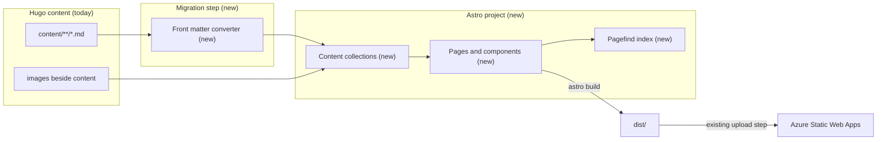

# Proposal

## Why

The Dapr Chinese community site (`cn.dapr.io`, repository `dapr-cn-site`) is still a Hugo 0.97.3 site that depends on a 2022 Wowchemy theme fork pulled in through Go modules. The theme is stale, the build needs Go plus a pinned Hugo binary, and the repository has no local layouts, so any visual or behavioural change means working inside an upstream theme fork. The sibling HagiCode documentation sites already run on Astro 7 with content collections, pnpm and scripted verification, which gives us a proven pattern to follow. Moving to Astro makes the site maintainable with the same toolchain the rest of the workspace uses.

## What Changes

- Replace the Hugo/Wowchemy project in `repos/dapr-cn-site` with an Astro 7 project that uses plain Astro with content collections. Starlight is not used: the site is a landing page plus blog, events and publications, not a documentation tree.
- Adopt the conventions of `hagicode-mono/repos/docs` (read-only reference): `astro.config.mjs` with `site`/`base`, a typed `src/content.config.ts`, pnpm, Pagefind search, and `verify:*` scripts.
- Migrate all 61 markdown files and their images into content collections: `post` (15), `event` (5), `publication` (5), `authors` (11), plus the static pages (`tour`, `people`, `meeting`, `translation`).
- Convert the 9 TOML front matter files and the 6 files without front matter to one YAML schema, so every entry validates against a single zod schema.
- Rebuild the seven active home sections (hero, featurette, upcoming events, event review, featured posts, recent posts, tag cloud) as Astro components, and rebuild the navbar, footer and day/night toggle with a Dapr-branded design.
- Preserve public URLs: `/post/<slug>/`, `/event/<slug>/`, `/publication/<slug>/`, `/author/<slug>/`, `/tag/<slug>/` (including percent-encoded Chinese tags), and `/tour/`, `/people/`, `/meeting/`, `/translation/`. A build-time check compares the new route set with the Hugo sitemap.
- Replace Hugo-generated outputs: RSS, sitemap, `robots.txt`, Google Analytics `G-J4DYYVC8KL` and search.
- Keep `/source` and `/case` as external links to the sibling Hugo sites. They are not rebuilt here.
- Move the build and CI workflows from Go/Hugo (`public/`) to Node/pnpm/Astro (`dist/`), keeping the existing Azure Static Web Apps upload step.
- **BREAKING**: remove the Hugo toolchain files (`go.mod`, `go.sum`, `theme.toml`, `netlify.toml`, `HUGO_VERSION.md`, the `config/` tree, `content/admin/`) and the Wowchemy CMS stub. The site can no longer be built with Hugo after this change.
- **BREAKING**: the visual design changes from the Wowchemy "1950s" theme to a clean Dapr-branded design. URLs and content are preserved; the look is not.

### Interaction flow



*Caption: content moves from Hugo files through a one-off front matter conversion into typed collections, then through pages into the same Azure upload. Supports the What Changes section.*

### Home page prototype

```
┌────────────────────────────────────────────────────────────────┐
│ [Dapr logo] Dapr 中国社区   介绍 活动 博客 翻译 源码 会议 案例 出版 成员  [🔍][☾] │
├────────────────────────────────────────────────────────────────┤
│                         Dapr 中国社区                          │
│   Dapr 是一个可移植的、事件驱动的运行时 ...                    │
│              [阅读博客]   [加入翻译小组]                       │
├────────────────────────────────────────────────────────────────┤
│  社区能做什么 (featurette)                                     │
│  [学习 & 分享]   [文档翻译]   [源码解读]                       │
├────────────────────────────────────────────────────────────────┤
│  近期活动                  │  活动回顾                          │
│  ▢ 活动卡片                │  ▢ 活动卡片                        │
├────────────────────────────────────────────────────────────────┤
│  热门文章                                                      │
│  ┌──────────┐ ┌──────────┐ ┌──────────┐                        │
│  │ 封面     │ │ 封面     │ │ 封面     │                        │
│  │ 标题     │ │ 标题     │ │ 标题     │                        │
│  └──────────┘ └──────────┘ └──────────┘                        │
├────────────────────────────────────────────────────────────────┤
│  最新文章 (list)             标签云: Dapr 微服务 actor 翻译 ...│
├────────────────────────────────────────────────────────────────┤
│ © 2026 Dapr 中国社区版权所有                                   │
└────────────────────────────────────────────────────────────────┘
```

## Capabilities

### New Capabilities

- `site-content-model`: Typed content collections for posts, events, publications and authors, the unified YAML front matter schema, colocated images, and the static pages.
- `site-routing-and-url-parity`: Route structure, trailing-slash behaviour, tag and author archive pages, and the guarantee that existing public URLs keep resolving.
- `site-home-and-navigation`: Home page sections, primary navigation, external links to `/source` and `/case`, footer, and day/night theme toggle in the Dapr-branded design.
- `site-search-and-feeds`: Pagefind site search, RSS feed, sitemap, `robots.txt` and Google Analytics.
- `site-build-and-delivery`: Astro/pnpm project scaffold, verification scripts, the CI build workflow producing `dist/`, and removal of the Hugo toolchain.

### Modified Capabilities

None. `openspec list --specs` reports no existing specs, so every capability above is new.

## Impact

- **Affected repository:** only `repos/dapr-cn-site`. The HagiCode docs project at `/home/newbe36524/repos/hagi/hagicode-mono/` is read for conventions and is not modified.
- **Out of scope:** rewriting article text, rebuilding `/source` and `/case` (they live in `dapr-cn-site-source` and `dapr-cn-site-case`), fixing the 7 hotlinked `wework.qpic.cn` images, adding comments or extra languages, and DNS or hosting changes.
- **Dependencies:** adds `astro`, `@astrojs/rss`, `sharp`, `pagefind` and a TOML parser used by the one-off converter (`zod` comes through Astro). Removes the Go and Hugo requirements.
- **Systems:** `.github/workflows/release.yml` and `hugo-build.yml` change to Node/pnpm. The Azure Static Web Apps upload stays, with `app_location` pointing at `dist`.
- **Risk:** URL regressions on the live site, CJK tag slug encoding, and Hugo-only outputs (JSON index, web manifest, `headers`/`redirects`) that need an explicit keep-or-drop decision, recorded in `design.md`.

### Assumptions

- **Plain Astro with content collections, not Starlight.** The content is a community landing page, blog, events and publications. Starlight's sidebar layout does not fit it.
- **Clean Dapr-branded redesign instead of recreating Wowchemy.** The old theme is from 2022, and a redesign costs less than matching it pixel for pixel.
- **Pagefind for search.** It replaces the built-in Wowchemy search with no external service, and HagiCode docs already use it.

### Code change table

All paths are relative to `repos/dapr-cn-site/`.

| File Path | Change Type | Change Reason | Impact Scope |
|-----------|-------------|---------------|--------------|
| `package.json`, `pnpm-lock.yaml`, `pnpm-workspace.yaml`, `tsconfig.json` | Add | Astro/pnpm toolchain following `hagicode-mono/repos/docs` | Build |
| `astro.config.mjs` | Add | `site: https://cn.dapr.io`, `trailingSlash: 'always'`, directory build format | Build, routing |
| `src/content.config.ts` | Add | Typed collections `post`, `event`, `publication`, `authors` | Content model |
| `src/content/post/**`, `src/content/event/**`, `src/content/publication/**`, `src/content/authors/**` | Move + modify | Moved from `content/`, front matter converted to YAML | Content |
| `src/pages/index.astro`, `src/pages/[...collection]/**`, `src/pages/tag/[tag].astro`, `src/pages/author/[slug].astro` | Add | Home, list, detail, tag and author pages | Routing, UI |
| `src/pages/tour.astro`, `people.astro`, `meeting.astro`, `translation.astro` | Add | Static pages migrated from `content/tour`, `people`, `meeting`, `translation` | Routing, UI |
| `src/components/**`, `src/layouts/**`, `src/styles/**` | Add | Header, footer, home sections, cards, theme toggle, base styles | UI |
| `src/config/nav.ts`, `src/config/site.ts` | Add | Replaces `config/_default/menus.yaml` and `params.yaml` | Navigation, SEO |
| `src/pages/index.xml.ts`, `src/pages/sitemap.xml.ts`, `public/robots.txt` | Add | Replace Hugo RSS, sitemap and `enableRobotsTXT` at the same URLs | Feeds |
| `public/` (logo, icons, media) | Add | Moved from `assets/media/` and `static/` | Assets |
| `scripts/convert-front-matter.mjs` | Add | One-off conversion of TOML and missing front matter to YAML | Migration |
| `scripts/verify-url-parity.mjs`, `scripts/verify-content.mjs` | Add | Compare routes with the Hugo sitemap, check links and images | Verification |
| `.github/workflows/release.yml`, `.github/workflows/hugo-build.yml` | Modify | Replace Go/Hugo steps with Node/pnpm/Astro and `dist/` | CI |
| `README.md`, `.gitignore`, `.devcontainer/**`, `.gitpod.yml` | Modify | Document the Astro workflow and ignore `dist/`, `.astro/` | Docs, tooling |
| `go.mod`, `go.sum`, `theme.toml`, `netlify.toml`, `HUGO_VERSION.md`, `config/**`, `content/admin/**`, `content/home/**`, `assets/scss/**` | Delete | Hugo and Wowchemy leftovers | Repo hygiene |

## Involved Repositories

| Repository Name | Path | Edit Permission | Purpose |
| --- | --- | --- | --- |
| dapr-cn-site | repos/dapr-cn-site | [editable] | Current change context |
