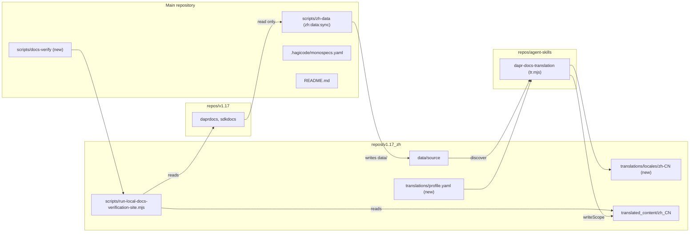
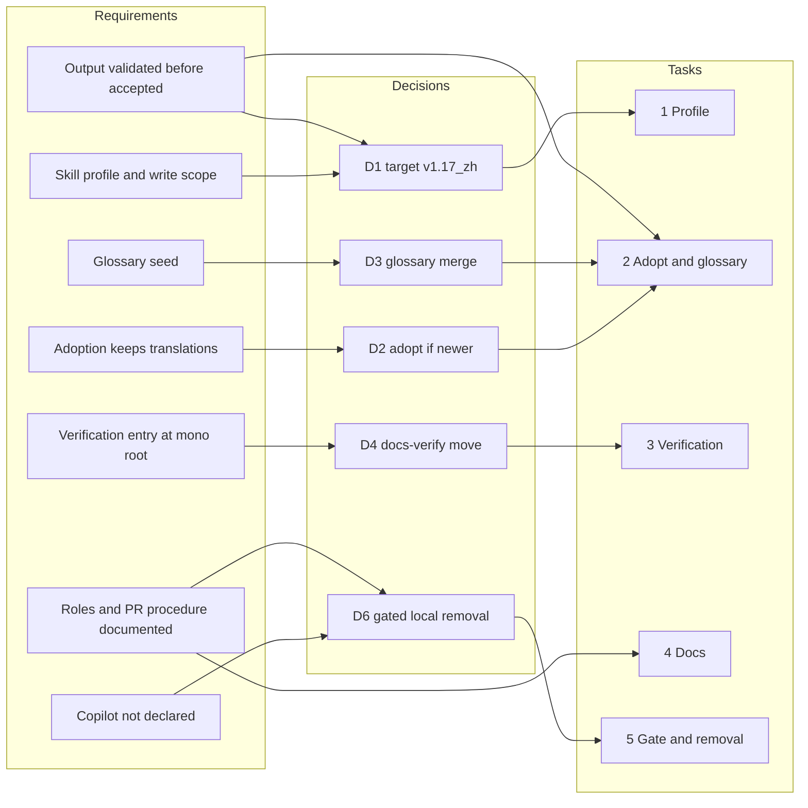
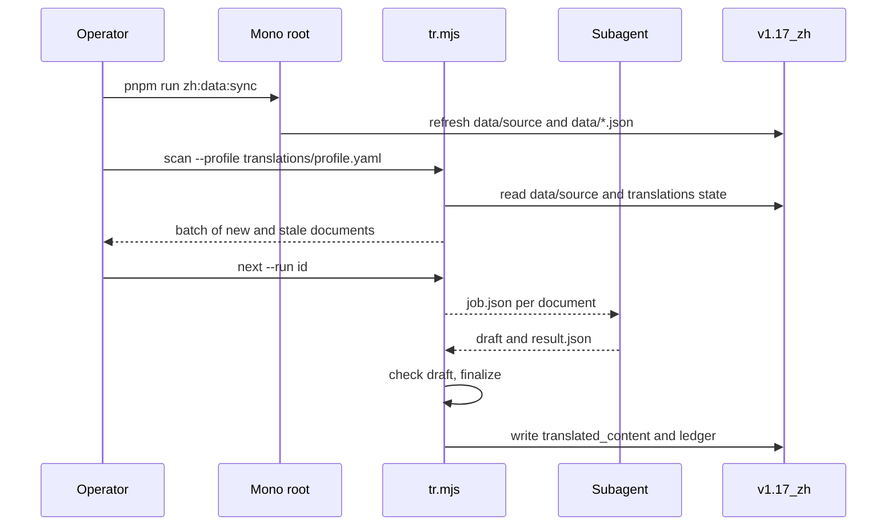

# Design

## Context

See `proposal.md` for motivation and the repository role table. Facts that shape the approach, all read from the workspace:

- The skill (`repos/agent-skills/dapr-docs-translation`) reads a `profile.yaml` from its target repository. Its `sources.glob.root` makes the document name the path relative to that root, and `output.template` maps `{doc}` to the translated file. It writes only the profile's `writeScope`, never edits the profile, and commits with path-limited commits. It has `init`, `scan`, `adopt`, `next`, `finalize`, `glossary merge|bootstrap|audit` and a checker for front matter keys, headings, code, links and anchors.
- `repos/v1.17_zh` (`dapr/docs-zh`, branch `v1.17_content`) already holds an English mirror at `data/source` (629 Markdown files) beside `translated_content/zh_CN` (628 files), with identical relative layout. The mono `zh:data:sync` refreshes `data/` from `repos/v1.17`. `data/` currently has 52 uncommitted files from that sync.
- `repos/docs` (`dapr-cn/docs`) holds a different, older Crowdin-managed tree (553 source, 553 translated files). It carries no copilot reference.
- The copilot's remaining value, beyond what the skill replaces, is one entry point: `docs:verify` (171 lines) with a 341-line test, which launches the runner scripts that already live in `repos/v1.17_zh/scripts/`. Its workspace-root default is `../../..` from the copilot's `scripts/`.
- `data/translation-state.json` was written only by the copilot. The mono `sync_source_documents.ts` reads it only if present (`existsSync`), and the integrity audit uses it as one of several stages.
- `.hagicode/monospecs.yaml` does not declare `repos/fork-v1.15` or `repos/fork-v1.17` even though a main spec says it should. The only fork checkout is `repos/fork-docs`.

## Goals / Non-Goals

**Goals:**
- One translation path: the skill, with `repos/v1.17_zh` as its target and no second state or glossary.
- No loss of existing translation work: adoption records hashes and rewrites no translated file.
- Every copilot entry point either has a replacement or is explicitly dropped, before the repository is removed.
- The removal is gated and reversible until the final step.

**Non-Goals:**
- Retiring or archiving `dapr-cn-site-case`, `dapr-cn-site-source` or `dapr-cn.github.io`, or editing `dapr-cn-site`.
- Changing the skill's code or adding repository facts to it.
- Making the skill write `data/translation-state.json` (see D5).
- Deleting the remote `dapr-cn/dapr-docs-copilot` GitHub repository or closing its Renovate pull request.
- Reviving `v1.15_zh`, or adding a profile for `docs`.

## Architecture

*Caption: the skill reads the mirror that the mono sync maintains and writes only the profile's scope; the verification entry now lives in the mono root. Supports Decisions D1, D2 and D4.*

## Decisions

### D1. Target repository is `repos/v1.17_zh`, not `repos/docs`

The profile uses `sources.glob.root: data/source` and `output.template: translated_content/zh_CN/{doc}`; `writeScope: [translations/, translated_content/]`; `readOnly: [data/, site/, scripts/]`.

- **Why:** the mirror and the translated tree are already in the same repository with the same layout, so plain glob discovery works with no adapter. It holds the full corpus (628 files) that the copilot produced, so adoption keeps the work. The sync stays in the mono root and the skill never touches `data/`.
- **Alternative: `repos/docs`.** It keeps state out of a clone of the official `dapr/docs-zh`, but its translated tree (553 files) differs from `v1.17_zh` (628) and has no English mirror, so it needs an adapter plus a reconciliation of the two trees first. It stays a legacy Crowdin repository.
- **Alternative: a separate state repository.** It would split the profile from its output and break the skill's "repo-relative" rule.
- **Consequence:** `translations/` state lands in a clone of an upstream-named repository. The remote is `dapr/docs-zh` but the branch history is by the maintainer, so this is accepted; it is reversible by deleting `translations/`.

### D2. Adopt with `--if-translation-newer`, dry run first

`tr.mjs adopt --dry-run`, review the skipped list, then `adopt --if-translation-newer`. Documents skipped as stale stay `stale` and are retranslated incrementally by later runs.

- **Why:** adopting everything would mark 42 known stale translations (`staleTranslation: 42` in `sync-status.json`) as current.
- **Alternative: adopt all.** Fastest, but hides real staleness. Rejected.

### D3. Glossary seed through `glossary merge --file`, not a hand edit

Convert the 7 entries of `data/glossary.json` (`source`, `target`, `notes`) to the candidate shape `[{doc, source, target, note}]` in the scratch area and merge them.

- **Why:** `merge` applies the skill's quality gate and never overwrites an existing preferred translation, which matches the spec scenario.
- **Trade-off:** merged terms get `origin: auto` and need promotion evidence. With only 7 terms, the operator may mark them `origin: human` by hand afterwards; that is a human edit, not part of this change.
- **Alternative: `glossary bootstrap`** from `externalTranslations.evidence`. It learns from upstream translations instead of the copilot's curated terms, so it is not used for the seed.

### D4. Verification entry moves to `scripts/docs-verify/` at the mono root

Copy `start-local-docs-verification.ts` and its test, and change only the workspace-root default (the mono root is two directories above `scripts/docs-verify/`, not three above the copilot's `scripts/`). Register `docs:verify` and `docs:verify:test` in the mono `package.json`. The `v1.17_zh` runner scripts are untouched.

- **Why:** it is the only copilot entry point with no skill equivalent, it is small, and it already targets the `v1.17_zh` runners.
- **Alternative: drop it.** Operators would have to invoke the runner by hand with four arguments, and a main spec requires the entry.
- **Alternative: move it into `v1.17_zh/scripts/`.** That repository is an upstream-named clone; the mono root already hosts shared entry points (`zh:data:*`), so it stays consistent.

### D5. `translation-state.json` is frozen, not bridged

After the copilot is gone nothing updates `data/translation-state.json`. The sync keeps reading it when present, and the integrity audit keeps its stage; both tolerate absence. Progress is read from the skill (`tr.mjs status`).

- **Why:** a bridge (export skill snapshot to the copilot's JSON) adds a new component to preserve a file whose only writer is being retired, and would change the audit's contract.
- **Cost:** the audit's `translation-state` stage can report a document as mismatched once the skill retranslates it. This is a known limitation, listed in the proposal. A later change decides between a bridge and removing the stage.

### D6. Removal is gated and local only

The copilot is removed in this order: parity gate, delete its declaration and README row, then remove the local clone (a clean working tree with no commits ahead of `origin/main`, which was true at exploration time: 0 uncommitted files, 0 ahead). Nothing is pushed or deleted on GitHub.

- **Why:** the clone is the only local copy of tooling that is still being compared against; removing the declaration first stops `sync:repos` from re-cloning it.
- **Alternative: `git rm` inside a mono-tracked directory.** `repos/` is untracked in the mono repository, so the deletion is a workspace operation and the tracked changes are the declaration and README.

### D7. Specs: retire four capabilities, trim three, add one

Requirements are mapped as follows. The retired set has no behavior left after removal. `zh-translation-integrity-audit` is kept unchanged because the audit lives in mono scripts.

*Caption: every requirement reaches a decision and a task group; the output-validation requirement is satisfied by the skill's checker, exercised in task group 2. Supports the traceability of the delta specs.*

## Sequence: a translation run after migration

*Caption: the sync refreshes the mirror first, the skill decides what is new or stale, and subagents only return drafts that `finalize` validates before writing. Supports D1 and D5.*

## Detailed code change inventory

| File Path | Change Type | Change Description | Affected Module |
|-----------|-------------|-------------------|-----------------|
| `repos/v1.17_zh/translations/profile.yaml` | Add | Written by `tr.mjs init`, then completed: description, `readOnly`, `priority` (guides and concepts first), `rules` (front matter `aliases` and relative links are kept as in the source), budgets, `models`, `commit.messagePrefix` | Skill target |
| `repos/v1.17_zh/translations/README.md`, `locales/zh-CN/{drafts,state,glossary,runs}/` | Add | Scaffold from `init`; `state/` filled by `adopt` | Skill state |
| `repos/v1.17_zh/translations/locales/zh-CN/glossary/glossary.json` | Add | Seed from `data/glossary.json` via `glossary merge --file` | Terminology |
| `repos/v1.17_zh/README.md` | Modify | Document the skill workflow, that `data/` belongs to `zh:data:sync`, and the verification command | `v1.17_zh` docs |
| `scripts/docs-verify/start-local-docs-verification.ts` | Add | Moved copy; workspace-root default recomputed for the new location; no other behavior change | Mono tooling |
| `scripts/docs-verify/tests/validate-local-docs-verification.ts` | Add | Moved copy; import paths adjusted | Mono tooling |
| `package.json` | Modify | `docs:verify`, `docs:verify:test` scripts | Mono tooling |
| `.hagicode/monospecs.yaml` | Modify | Remove the `repos/dapr-docs-copilot` entry only | Provisioning |
| `README.md` | Modify | Repository table without the copilot, repository roles, skill workflow, verification command, `fork-docs` PR procedure, `translation-state.json` note | Operator docs |
| `repos/dapr-docs-copilot/**` | Delete | Local clone removed after the gate | Workspace |
| `repos/agent-skills/**` | No change | `tr.mjs scan` run against the new profile is the compatibility check | Skill |
| `repos/docs/**`, `repos/fork-docs/**`, `repos/v1.17/**`, `repos/v1.15/**`, `repos/v1.15_zh/**` | No change | Roles assessed; no copilot reference | None |
| `repos/dapr-cn-site/**`, `repos/dapr-cn-site-case/**`, `repos/dapr-cn-site-source/**`, `repos/dapr-cn.github.io/**` | No change | Out of scope; in-flight change owns the first three | None |

## Risks / Trade-offs

- [Dirty `v1.17_zh/data` (52 files) is swept into a commit] → The profile declares `data/` read-only and commits are path-limited to `translations/` and `translated_content/`; a task verifies `git status` for `data/` is unchanged after every skill step.
- [Adoption hides stale translations] → D2 uses `--if-translation-newer` and a reviewed dry run; the 42 stale files remain `stale`.
- [Glob picks up non-document files in `data/source`] → A task compares the discovered document count with the 629 Markdown files and reviews any difference before adoption.
- [Moved `docs:verify` resolves the wrong root] → Its test runs from the mono root, and the default `--source-repo` and `--zh-repo` resolution is asserted in that test.
- [Audit reports false drift because `translation-state.json` is frozen] → Documented limitation (D5); a task records the audit result before and after so the delta is understood.
- [Removing the copilot loses a feature nobody mapped] → The parity table in `proposal.md` maps every copilot script group; the gate re-checks it before deletion.
- [Concurrent in-flight change edits the root `README.md` or `package.json`] → This change edits only the repository table, the roles section, and two scripts; a task re-reads both files immediately before editing.

## Migration Plan

1. Scaffold and complete the profile in `repos/v1.17_zh`; check discovery count.
2. Adopt (dry run, then real), seed the glossary, run `scan` and `status --verify`; confirm no `untracked` documents and no change to `data/`.
3. Move the verification entry to the mono root; run its test and a start of the site.
4. Update the READMEs (mono root and `v1.17_zh`).
5. Run the parity gate; then remove the copilot declaration, README row and local clone.

**Rollback:** steps 1 to 4 are additive (delete `translations/` and the new scripts to undo). Before step 5 completes, nothing is deleted. After removal, the clone can be restored with `git clone https://github.com/dapr-cn/dapr-docs-copilot.git repos/dapr-docs-copilot` and the declaration entry re-added.

## Open Questions

- Whether to promote the 7 seed terms to `origin: human` after the first run. It does not change the specs or tasks.
- Whether a later change should bridge or remove the audit's `translation-state` stage (D5).
