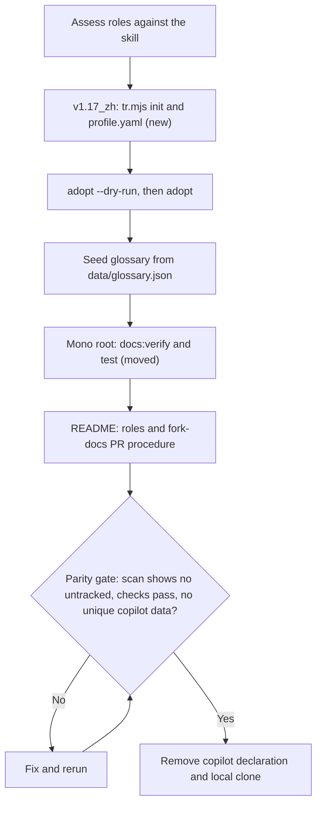

# Proposal

## Why

The Chinese Dapr documentation is now translated by the `dapr-docs-translation` skill (`repos/agent-skills`): a `profile.yaml` in the target repository, a durable ledger and glossary under `translations/`, subagents for the text, and a deterministic checker. The older path, `repos/dapr-docs-copilot` (a Vite workbench that shells out to `claude`), duplicates that job with a second state model (`data/translation-state.json`), a second glossary (`data/glossary.json`) and a second validator. No repository has a defined role under the skill, so nothing says where the profile lives, which repositories are read-only sources, or what happens to the copilot features that have no skill equivalent (the local verification site entry and the PR workbench). The data layer was already moved to the mono root by the archived change `plan-translation-workbench-migration-to-mono-repository`, which left copilot removal for a later change. This is that change.

## Involved Repositories

| Repository Name | Path | Edit Permission | Purpose |
| --- | --- | --- | --- |
| docs | repos/docs | [editable] | Current change context |
| dapr-docs-copilot | repos/dapr-docs-copilot | [editable] | Current change context |
| agent-skills | repos/agent-skills | [editable] | Current change context |
| fork-docs | repos/fork-docs | [editable] | Current change context |
| dapr-cn-site | repos/dapr-cn-site | [editable] | Current change context |
| dapr-cn-site-source | repos/dapr-cn-site-source | [editable] | Current change context |
| dapr-cn-site-case | repos/dapr-cn-site-case | [editable] | Current change context |
| dapr-cn.github.io | repos/dapr-cn.github.io | [editable] | Current change context |
| v1.17 | repos/v1.17 | [editable] | Current change context |
| v1.17_zh | repos/v1.17_zh | [editable] | Current change context |
| v1.15 | repos/v1.15 | [editable] | Current change context |
| v1.15_zh | repos/v1.15_zh | [editable] | Current change context |

## What Changes

- **Define the role of every listed repository** under the skill (table below), and record it in the mono `README.md`.
- **Make `repos/v1.17_zh` the skill's target repository.** Add `translations/profile.yaml` there: sources are the English mirror `data/source/**/*.md` (kept current by the mono `zh:data:sync`), output is `translated_content/zh_CN/{doc}`, `writeScope` is `translations/` and `translated_content/`, and `data/`, `site/` and `scripts/` are read-only. Scaffold it with `tr.mjs init`, never by hand-copying skill internals.
- **Adopt the existing translations** as the skill's baseline with `tr.mjs adopt` (dry run first, `--if-translation-newer`), so the roughly 596 translated documents are not retranslated.
- **Carry the glossary over.** The 7 terms in `v1.17_zh/data/glossary.json` become the skill's `glossary.json` through `tr.mjs glossary merge --file`, so the first skill run starts with the terminology the copilot already used.
- **Move the local verification site entry to the mono root.** `docs:verify` and its test move from `repos/dapr-docs-copilot/scripts/` into `scripts/docs-verify/` as `docs:verify` and `docs:verify:test`. The runner scripts stay in `repos/v1.17_zh/scripts/`.
- **Replace the PR workbench with a documented manual procedure** for `repos/fork-docs` (fast-forward the fork, switch the `translations/docs-zh` submodule, build locally) in the mono `README.md`.
- **Remove `repos/dapr-docs-copilot`** after a parity gate passes: delete its entry from `.hagicode/monospecs.yaml`, remove its row from the `README.md` repository table, and remove the local clone. The remote GitHub repository is not touched by this change.
- **Retire the specs that only described the copilot**: `zh-translation-workbench`, `zh-data-console`, `zh-glossary-inline-editing` and `zh-translation-output-validation` (their behavior is replaced by the skill), plus the copilot-specific requirements of `translation-workbench-workspace`, `workbench-checkout-provisioning` and `zh-local-docs-verification-site`.
- **BREAKING** for anyone who runs `pnpm run dev` or any `translation-*`, `pr-workbench:*` or `docs:verify` command inside `repos/dapr-docs-copilot`: the repository is gone and `docs:verify` moves to the mono root.
- **Known limitation, not fixed here:** `data/translation-state.json` was written only by the copilot. After removal it is frozen. `zh:data:sync` and the integrity audit still read it when present and tolerate its absence. Translation progress is tracked by the skill's `translations/` snapshot from now on (see design D5).

### Repository roles

| Repository | Role under the skill | Action in this change |
|---|---|---|
| `repos/v1.17_zh` | Translation target and data home: holds `translations/` state and `translated_content/zh_CN` output | Add profile, adopt baseline, seed glossary, update README |
| `repos/v1.17` | Upstream English source, read-only; feeds `data/source` through `zh:data:sync` | No change |
| `repos/v1.15_zh`, `repos/v1.15` | Frozen optional version (last commit 2025-07-12); no profile until it is revived | No change |
| `repos/agent-skills` | Owns the skill; carries no repository facts | No change to skill code; verified against the new profile |
| `repos/docs` | Legacy Crowdin-managed content; not a skill target | No change (content and workflows preserved) |
| `repos/fork-docs` | Fork of `dapr/docs` used to open upstream PRs by hand | No change; its procedure is documented in the mono `README.md` |
| `repos/dapr-docs-copilot` | Superseded workbench | Remove after the parity gate |
| `repos/dapr-cn-site` | Community website, unrelated to translation | No change (in-flight transfer change owns it) |
| `repos/dapr-cn-site-case`, `repos/dapr-cn-site-source` | Stale content repositories | No change (in-flight transfer change owns them) |
| `repos/dapr-cn.github.io` | Stale gh-pages output (2021) | No change |
| Main repository `.` | Management root: declarations, scripts, specs | Modify (table below) |

### Migration flow

*Caption: the copilot is removed only after the skill reproduces its baseline and its one surviving entry point lives at the mono root. Supports the What Changes section.*

### Code change table

| File Path | Change Type | Change Reason | Impact Scope |
|-----------|-------------|---------------|--------------|
| `repos/v1.17_zh/translations/profile.yaml` | Add | Defines sources, output, write scope and read-only paths for the skill | Translation runs |
| `repos/v1.17_zh/translations/README.md` and `locales/zh-CN/**` | Add (generated by `tr.mjs init`, state by `adopt`) | Durable ledger, snapshot, glossary, drafts | Translation state |
| `repos/v1.17_zh/translations/locales/zh-CN/glossary/glossary.json` | Add | Seed from the 7 copilot terms | Terminology |
| `repos/v1.17_zh/README.md` | Modify | Replace workbench wording with the skill workflow and ownership of `data/` | `v1.17_zh` docs |
| `repos/v1.17_zh/data/**`, `translated_content/**` (other than adoption) | No change | `data/` stays owned by `zh:data:sync`; adoption records hashes only | None |
| `scripts/docs-verify/start-local-docs-verification.ts` | Add (moved from copilot) | Keep the one-command verification entry | Local verification |
| `scripts/docs-verify/tests/validate-local-docs-verification.ts` | Add (moved from copilot) | Keep the entry's test beside it | Verification test |
| `package.json` (mono root) | Modify | Add `docs:verify` and `docs:verify:test` | Mono toolchain |
| `.hagicode/monospecs.yaml` | Modify | Remove the `repos/dapr-docs-copilot` entry | Provisioning |
| `README.md` (mono root) | Modify | Repository table, roles, skill workflow, verification command, fork-docs PR procedure | Operator docs |
| `repos/dapr-docs-copilot/**` | Delete (local clone) | Superseded; removed after the parity gate | Workspace |
| `openspec/specs/zh-translation-workbench`, `zh-data-console`, `zh-glossary-inline-editing`, `zh-translation-output-validation` | Retire | Behavior moves to the skill | Specs |
| `openspec/specs/translation-workbench-workspace`, `workbench-checkout-provisioning`, `zh-local-docs-verification-site` | Modify | Remove copilot-specific requirements; add the mono-root verification entry | Specs |
| `repos/agent-skills`, `docs`, `fork-docs`, `v1.17`, `v1.15`, `v1.15_zh`, `dapr-cn-site`, `dapr-cn-site-case`, `dapr-cn-site-source`, `dapr-cn.github.io` | Verify (no change) | Role assessed; no copilot references found | None |

## Capabilities

### New Capabilities
- `zh-translation-skill-workspace`: the zh translation target repository is driven by the skill through a profile, with adoption of existing translations, a seeded glossary, output validation by the skill's checker, a bounded write scope and dirty-tree safety.

### Modified Capabilities
- `translation-workbench-workspace`: remove the requirements about the copilot's workspace root and unchanged workbench behavior; keep the data-sync, workspace-check and docs-retirement requirements.
- `workbench-checkout-provisioning`: the declared version set no longer includes `fork-*` checkouts, and the requirement for separate fork checkouts is removed.
- `zh-local-docs-verification-site`: the one-command startup entry moves from `repos/dapr-docs-copilot` to the mono root.

### Retired Capabilities
- `zh-translation-workbench`, `zh-data-console`, `zh-glossary-inline-editing`, `zh-translation-output-validation`: every requirement is removed; the skill replaces them.

## Impact

- **Operators:** translation runs go through the skill (`tr.mjs scan`, `next`, `finalize`) against `repos/v1.17_zh`. The verification site starts with `pnpm run docs:verify` from the mono root. Upstream PRs for `fork-docs` follow the documented manual procedure.
- **Repositories:** `v1.17_zh` gains a `translations/` tree and its path-limited commits must never include `data/`, which has uncommitted `zh:data:sync` output today. `dapr-docs-copilot` disappears from the workspace. Nothing else changes.
- **Dependencies:** none added. `tsx` already exists at the mono root; the moved scripts reuse it.
- **Coordination:** `dapr-cn-site`, `dapr-cn-site-case` and `dapr-cn-site-source` are owned by the in-flight change `transfer-case-and-source-site-content-to-official-website`. This change does not edit them.
- **Specs:** four capabilities are retired and three modified; the deltas live in this change and are not synced here.
