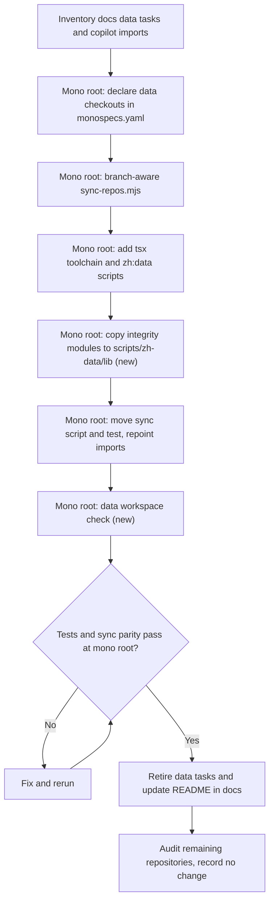

# Proposal

## Why

The zh translation data task layer (source-to-dataset sync, integrity audit, repository cloning, toolchain) lives in the `docs` repository, which today acts as a private mini mono root for the versioned checkouts (`repos/v1.17`, `repos/v1.17_zh`) and for `repos/dapr-docs-copilot`. The `dapr-cn-mono` repository was created to be the single management root for the dapr-cn organization, yet it cannot produce or audit the translation datasets: it has no `tsx`, no `zh:data:sync` task and no declaration of the versioned checkouts.

The copilot (workbench UI, PR workbench, local verification site, translation execution) is going to be removed in a later change, so it should not drive this migration. Only the key data part moves: the dataset sync and integrity logic, the checkouts it reads and writes, and the toolchain to run them. That part must stop depending on code that is about to disappear.

## What Changes

- Move the zh data sync task and its test from `repos/docs/scripts/zh-data/` to the mono root's `scripts/zh-data/`, exposed as `zh:data:sync` and `zh:data:test` in the mono `package.json`.
- Carry the integrity logic the sync task depends on out of the copilot: copy `translation-integrity-audit.ts` and `translation-integrity-models.ts` (both use only Node built-ins) into `scripts/zh-data/lib/`, repoint the two imports in the sync script to them, and add `zh:data:repair` (a copy of the 50-line `repair-translation-integrity.ts` entry) so audit and repair stay reachable. After this, `scripts/zh-data/**` has no import from `repos/dapr-docs-copilot`.
- Add `tsx`, `typescript` and `@types/node` to the mono `package.json` and `pnpm-lock.yaml`. All commands use pnpm, as in the other dapr-cn repositories: add a mono-root `pnpm-workspace.yaml` that allows the `esbuild` build script (`tsx` needs its platform binary, and pnpm 12 reads this setting from that file) and pin `packageManager` to the same pnpm version `repos/docs` uses.
- Treat the pnpm conversion already present in `repos/docs` (`pnpm-lock.yaml`, `pnpm-workspace.yaml`, `packageManager`, pnpm commands in its README) as the baseline: later edits to `repos/docs` build on it and never revert it.
- Declare only the checkouts the data task needs in `.hagicode/monospecs.yaml`: `v1.17` and `v1.17_zh` (required), `v1.15` and `v1.15_zh` (optional), each with its `branch`. Teach `scripts/sync-repos.mjs` the `branch` and `optional` fields that `docs/scripts/clone-repos.mjs` supports today, keeping its "never touch a dirty tree" guarantee.
- Add a read-only data workspace check at the mono root that reports a missing checkout, missing `tsx` or missing `zh:data:sync` task with an actionable message.
- Retire the data tasks from `repos/docs` after the mono root passes validation: remove `scripts/zh-data/**`, `scripts/clone-repos.mjs`, `monospecs.yaml` and the `zh:data:*` and `clone:*` package scripts, and the dependencies and pnpm build allowance that only those scripts needed; keep `docs` as content only (`src/content`, `src/translated_content`, Crowdin workflows).
- Update `repos/docs/README.md` ("源码同步") and `repos/docs/SRC_TRANSLATION_BUILD_ANALYSIS.md` to point at the mono root.
- Audit the other target repositories for references to the old root and record "no change" where none exist.
- **Out of scope** (copilot-owned, to be removed later): the workbench UI and Vite dev endpoints, translation execution, translation output validation, alias normalization and backfill, the PR workbench, the local verification site, `fork-v1.15` and `fork-v1.17` checkouts, the copilot's test suites and README. `repos/dapr-docs-copilot` is not edited, and running it from the mono root is neither a goal nor a supported path of this change.

**BREAKING** for anyone who still runs `pnpm run zh:data:sync` or `pnpm run clone:repos` inside `repos/docs`: those entry points are removed after migration.

### Migration flow

*Caption: the docs data tasks are removed only after the mono root reproduces their results without any copilot import. Supports the Migration Steps and Transition sections.*

### Code change table

| File Path | Change Type | Change Reason | Impact Scope |
|-----------|-------------|---------------|--------------|
| `package.json` (mono root) | Modify | Add `zh:data:sync`, `zh:data:test`, `zh:data:repair`, `zh:data:check`, `sync:repos:test` scripts, `tsx`, `typescript`, `@types/node` dev dependencies and the `packageManager` pin | Mono root toolchain |
| `pnpm-lock.yaml` (mono root) | Modify | Lock the new dev dependencies | Mono root install |
| `pnpm-workspace.yaml` (mono root) | Add | pnpm 12 settings: `allowBuilds: esbuild: true` so `tsx` gets its platform binary | Mono root install |
| `.hagicode/monospecs.yaml` (mono root) | Modify | Declare `v1.17`, `v1.17_zh` (required) and `v1.15`, `v1.15_zh` (optional) with `branch` | Checkout provisioning |
| `scripts/sync-repos.mjs` (mono root) | Modify | Support `branch` and `optional`; keep dirty-tree skip and fast-forward-only pull | Checkout provisioning |
| `scripts/tests/sync-repos.test.mjs` (mono root) | Add | Test the provisioning behaviors | Provisioning validation |
| `scripts/zh-data/sync_source_documents.ts` (mono root) | Add (moved from docs) | Data sync task owned by the mono root; only the two copilot imports change | Datasets under `repos/*_zh/data` |
| `scripts/zh-data/tests/test_sync_source_documents.ts` (mono root) | Add (moved from docs) | Keep the task's test beside it | Sync validation |
| `scripts/zh-data/lib/translation-integrity-audit.ts` (mono root) | Add (copied from copilot) | Remove the sync task's dependency on the copilot | Integrity reconciliation |
| `scripts/zh-data/lib/translation-integrity-models.ts` (mono root) | Add (copied from copilot) | Types for the integrity datasets | Integrity reconciliation |
| `scripts/zh-data/repair_translation_integrity.ts` (mono root) | Add (copied from copilot) | Keep integrity audit and repair reachable after the copilot is removed | Integrity repair |
| `scripts/check-zh-data-workspace.mjs` (mono root) | Add | Read-only precondition check | Operator diagnostics |
| `README.md` (mono root) | Modify | Document the data tasks, checkout set and check command | Operator docs |
| `repos/docs/scripts/zh-data/**` | Delete | Task ownership moves to the mono root | `docs` |
| `repos/docs/scripts/clone-repos.mjs` | Delete | Replaced by mono `sync-repos.mjs` | `docs` |
| `repos/docs/monospecs.yaml` | Delete | Checkout declaration moves to the mono root | `docs` |
| `repos/docs/package.json`, `pnpm-lock.yaml`, `pnpm-workspace.yaml` | Modify | On top of the committed pnpm conversion: remove retired scripts, dependencies they alone needed, and the `esbuild` build allowance | `docs` |
| `repos/docs/README.md` | Modify | Replace the pnpm "源码同步" commands (`pnpm run clone:repos`) with a pointer to the mono root | `docs` docs |
| `repos/docs/SRC_TRANSLATION_BUILD_ANALYSIS.md` | Modify | Update references to removed scripts and the old root | `docs` docs |
| `repos/dapr-docs-copilot/**` | No change | Scheduled for removal; the only coupling (sync-script imports) is cut by copying two modules | None |
| `repos/fork-docs`, `dapr-cn-site`, `dapr-cn-site-case`, `dapr-cn-site-source`, `dapr-cn.github.io`, `docs-team`, `docsy`, `wowchemy-hugo-themes` | Verify (no change) | No references to the data tasks were found | None |

## Capabilities

### New Capabilities
- `translation-workbench-workspace`: the mono root hosts the zh data task layer. It provides the data sync, test and integrity repair tasks, the `tsx` toolchain and a workspace check, and the data task runs from the mono root with no dependency on the copilot.
- `workbench-checkout-provisioning`: the mono root declares the versioned source and zh checkouts the data task needs and provisions them with branch-aware, dirty-safe synchronization.

### Modified Capabilities
<!-- None. The existing zh-* specs name `repos/*_zh` and `repos/v1.17`, and those paths do not change. Copilot-facing behavior is left to the later removal change. -->

## Impact

- **Operators:** dataset sync and integrity repair are run from the mono root. Entry points inside `repos/docs` disappear.
- **Dependencies:** the mono root gains `tsx`, `typescript` and `@types/node`. `repos/docs` drops `animejs`, `chalk`, `cli-table3`, `commander`, `glob`, `ora` and `js-yaml`, which its remaining files do not use, and, once its scripts are retired, `tsx`, `typescript` and `@types/node`.
- **Package manager:** pnpm only. The mono root gets the same pnpm 12 setup (`pnpm-workspace.yaml`, `packageManager`) the other repositories already have; pnpm forwards script arguments directly, so commands are written `pnpm run zh:data:sync --source-repo ...` without `--`.
- **Duplicated code:** the integrity modules exist in both the mono root and the copilot until the copilot is removed. The mono root copy is the source of truth after migration; the copilot copy is frozen.
- **Data:** no translation content or `repos/*_zh/data/*.json` file changes because of the move. Checkouts are untracked (`repos/` is git-ignored) and are provisioned, not committed.
- **Copilot:** unchanged. Anything that relied on `docs` being its root (PR workbench, fork checkouts, `docs:verify`, translation execution) is not covered here.

## Involved Repositories

| Repository Name | Path | Edit Permission | Purpose |
| --- | --- | --- | --- |
| docs | repos/docs | [editable] | Current change context |
| dapr-docs-copilot | repos/dapr-docs-copilot | [editable] | Current change context |
| fork-docs | repos/fork-docs | [editable] | Current change context |
| dapr-cn-site | repos/dapr-cn-site | [editable] | Current change context |
| docs-team | repos/docs-team | [editable] | Current change context |
| docsy | repos/docsy | [editable] | Current change context |
| wowchemy-hugo-themes | repos/wowchemy-hugo-themes | [editable] | Current change context |
| dapr-cn-site-source | repos/dapr-cn-site-source | [editable] | Current change context |
| dapr-cn-site-case | repos/dapr-cn-site-case | [editable] | Current change context |
| dapr-cn.github.io | repos/dapr-cn.github.io | [editable] | Current change context |
