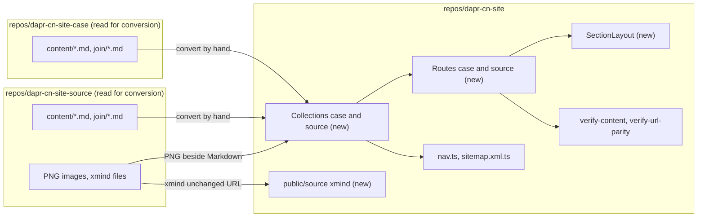
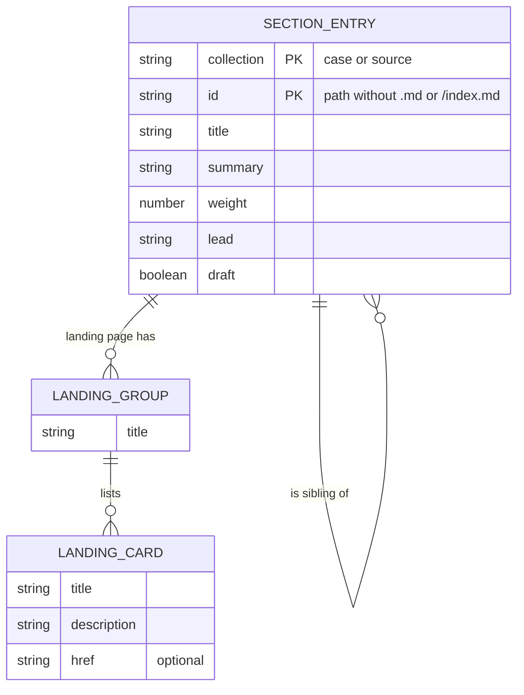
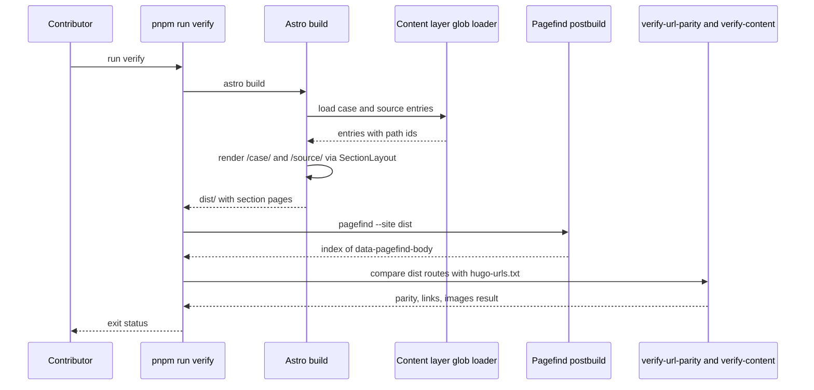
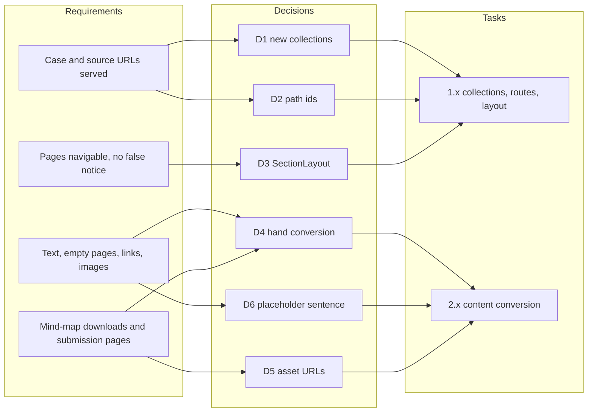
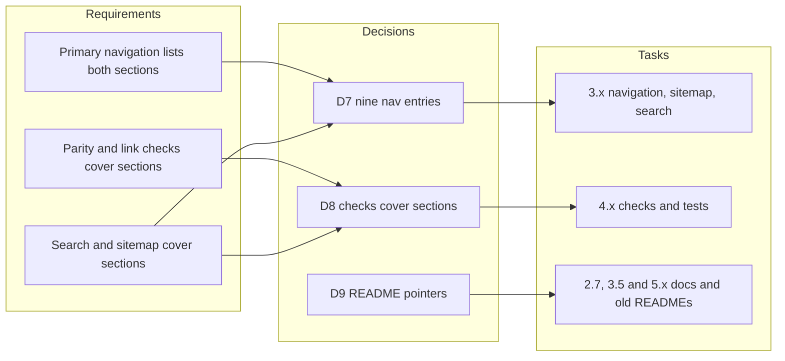

# Design

## Context

See `proposal.md` for the motivation. The facts below shape the approach.

- **Target:** `repos/dapr-cn-site` is an Astro 7 + Starlight static site (`trailingSlash: 'always'`, `build.format: 'directory'`). Every page renders through `BaseLayout.astro`, which wraps Starlight's `StarlightPage`. Content collections are declared in `src/content.config.ts` with the `glob` loader. The `site` collection already serves top-level pages through `src/pages/[...id].astro`, with the id as the path.
- **The `site` collection does not fit.** Its schema requires a `source` URL, and its template prints "translated from the official Dapr site". Both are wrong for community-authored case and study pages.
- **Sources:** `repos/dapr-cn-site-case` (7 pages, no images) and `repos/dapr-cn-site-source` (14 pages, 7 PNG images, 2 `.xmind` files). Both use Docsy shortcodes (`pageinfo`, `blocks/*`, `relref`) and Hugo front matter (`menu`, `cascade`, `weight`, `description`). Six pages have a title and no body.
- **Guards that currently forbid the transfer:** the archived requirement "Source and case sections remain reachable", `tests/nav.test.ts`, `EXTERNAL_SECTIONS` in `scripts/verify-content.mjs`, and a line in `PRODUCT.md`.
- **Checks that already help:** the build fails on a missing local image (`scripts/lib/local-images.mjs`), `verify-content.mjs` resolves relative links per entry, and `verify-url-parity.mjs` compares `dist/` with `scripts/hugo-urls.txt`.
- **Design guidance (read-only, `DESIGN.md` and `.impeccable/design.json`):** one accent (Brand Indigo), flat surfaces with 1px Hairline dividers and no shadows, colours only through role variables, no webfonts, 1.75 line-height with a 780px reading column, Pagefind indexes only `data-pagefind-body`, 3px focus ring and `aria-current='page'` on the active link, and sections without data render as nothing.
- **Hosting:** the site deploys to Azure Static Web Apps. No routing file for `/case` or `/source` exists in the repository.

## Goals / Non-Goals

**Goals:**
- Serve the 21 former pages at their old URLs from the one Astro build, with navigation, search and sitemap coverage.
- Make the rule change visible and enforced: the checks that skipped these sections now cover them.
- Keep the conversion reviewable: each page can be compared with its original.

**Non-Goals:**
- Writing new case or study content, or filling the six empty pages beyond one placeholder sentence.
- Converting the PNG images to AVIF, or refreshing outdated 2022 meeting links.
- Host-level redirects, deleting or archiving the old repositories, or any change to the translated `site` collection.
- Editing `DESIGN.md` or `.impeccable/design.json`.

## Decisions

### D1. Two new collections, `case` and `source`, instead of extending `site`

Both collections share one page schema and differ only in their base directory. The collection names equal the URL prefixes, which is what `baseRouteOf` in `verify-content.mjs` already assumes for unknown collections (`/<collection>/<id>`).

| Option | Result |
| --- | --- |
| Extend `site` with an optional `source` and a banner switch | Cheapest, but `[...id].astro` would branch on a flag and the schema would stop describing the translated pages |
| **Two new collections (chosen)** | Own routes, own layout, no false attribution, the same pattern as `post` and `event` |
| Starlight `docs` collection with a sidebar | Free sidebar, but the collection is empty today, Starlight injects its own catch-all route, and the masthead is customised; needs a spike with uncertain payoff |

Shared page fields: `title` (required), `summary` (optional, replaces Hugo `description`), `weight` (optional number, kept from Hugo for ordering), `lead` and `groups` (optional, used by landing pages; each group has an optional `title` and a list of cards with `title`, `description` and an optional `href`), `draft` (default false).

### D2. Ids are paths; the Hugo `_index.md` becomes `index.md`

The glob pattern is `**/*.md`. The id generator strips a trailing `/index.md` and then `.md`, as `pageId` already does for `site`. A root `index.md` yields the id `index`, which the route file maps to the section root (`params.id` is `undefined`). Hugo's `_index.md` files are renamed `index.md` when copied, so `join/_index.md` becomes `join/index.md` and the URL `/source/join/` is kept.

### D3. One `SectionLayout`, two thin route files

`src/pages/case/[...id].astro` and `src/pages/source/[...id].astro` only choose the collection and call shared helpers in `src/lib/sections.ts`. The layout wraps `BaseLayout` and adds:
- a breadcrumb (home, section, ancestors, current), outside the Pagefind body;
- a section list of sibling pages sorted by `weight` then title, with `aria-current='page'` on the current one; above the body below 960px, in a left rail from 960px;
- the Markdown body inside `.prose` in the 780px column with `data-pagefind-body`;
- previous and next links in the section order.

The landing page shows `lead` and one grid of bordered cards per group from front matter, using existing tokens (Pinboard Mist fill, 1px Hairline, 10px radius, no shadow, no cover); a card without `href` is a plain card, not a link. No translation banner is printed. Links and buttons use the existing pill and cobalt rules, and no colour is introduced.

```
Component Hierarchy
├── BaseLayout (existing, StarlightPage frame)
│   └── SectionLayout (new)
│       ├── Breadcrumb (new, inside SectionLayout)
│       ├── SectionList (new, sibling pages, aria-current)
│       ├── .prose  data-pagefind-body  (Markdown body)
│       ├── LandingCards (new, only when front matter has groups)
│       └── PrevNext (new)
```

### D4. Convert by hand; no migration script

The conversion is mostly editorial: shortcodes, the landing pages, the submission pages and six placeholders. A script would automate only the front matter. The 21 files are copied once and edited, then compared with the originals by `git diff --no-index`. Rules:
- `pageinfo` callouts become a Markdown blockquote, so the text stays visible.
- `blocks/cover`, `blocks/lead`, `blocks/section` and `blocks/feature` on the two landing pages become `lead` and `groups` front matter. The section headings between the feature blocks (欢迎投稿，分享你的落地实践！, 让 Dapr 用户和开发者更好的相互交流) become group titles or lead text.
- The case card 官网客户案例资料 pointed to the English `dapr.io/testimonials/`. It now links to this site's `/testimonials/`, which is the Chinese adaptation, and its text says so; this is the one deliberate wording change besides the Hugo and repository references.
- `relref "../x"` becomes a relative link `../x/`.
- `menu`, `cascade`, `linkTitle` and the Docsy `type` are dropped; `weight` is kept; `description: >` becomes `summary`.
- `search.md` is not carried; Pagefind replaces it (see the retired URL list).
- `featured-background.jpeg`, `config.toml`, Docker, Netlify and Go files are not carried.

### D5. Assets keep their old URLs where the URL is public

- PNG images stay in an `images/` folder beside the Markdown (as the post bundles do) and are referenced relatively, so Astro optimises them and the missing-image check covers them. Image URLs are not public contracts and become hashed `/_astro/…` files.
- The two `.xmind` files go to `public/source/join/knowledge-graph/` and `public/source/join/workitems/`. The existing relative link `./workitems.xmind` then resolves to `/source/join/workitems/workitems.xmind`, the old URL, and `verify-content.mjs` finds it in the public file set.

### D6. Body-less pages keep their URL with one sentence in the Markdown

The six pages carry the sentence "本页内容正在整理中，暂无正文。" in their own Markdown, not in layout logic, so contributors replace it by editing one file. The section list and breadcrumb still render. This keeps six URLs alive without inventing content; omitting them would break old links, and blank pages would look like a defect. The design guidance's "render sections with no data as nothing" applies to home-page widgets, not to pages that must keep a URL.

### D7. Nine community entries in the main navigation

`nav.ts` gains `{ name: '源码', href: '/source/', section: '/source/' }` after 翻译 and `{ name: '案例', href: '/case/', section: '/case/' }` after 会议, restoring the Hugo order. `currentNavItem` already matches by prefix. The footer splits entries with an allow-list (`/post/`, `/tag/translation/`, `/publication/` go to 阅读), so the new entries land in 社区 without code changes. The desktop bar currently switches at 1200px with seven entries plus the 了解 Dapr group; the implementation measures the bar at 1200px and raises the breakpoint only if the entries wrap or clip. The mobile menu is already a list and needs no structural change.

### D8. Verification covers the sections instead of skipping them

- `EXTERNAL_SECTIONS` is emptied (and its check removed), so links to `/case/` and `/source/` resolve against `dist/`.
- `loadEntries` reads the two new collections with path-based ids, the same way as `site`.
- `baseRouteOf` maps `<collection>/index` to `/<collection>/`, so relative links on the landing pages resolve from the right folder.
- The 21 URLs are appended to `scripts/hugo-urls.txt` under a comment that names the two former sites; `scripts/retired-urls.txt` maps `/case/search/` to `/case/` and `/source/search/` to `/source/`.

### D9. The old repositories get a README pointer only

`dapr-cn-site-case/README.md` and `dapr-cn-site-source/README.md` already advertise the public URLs, which stay valid. Each gains two sentences: the content now lives in `dapr-cn-site` under `src/content/case` or `src/content/source`, and contributions go there. Nothing is deleted.

## Architecture


*Caption: content flows one way from the two old repositories into the collections of `dapr-cn-site`, and only that repository owns routes, layout, navigation and checks. Supports Decisions D1 to D8.*

## Data Model


*Caption: an entry is keyed by collection and path id, only landing entries own groups of cards, and siblings are the entries sharing a parent path. Supports D1 to D3.*

## Build and Verification Sequence


*Caption: the new pages reach the search index only after the build, and the checks run against `dist/` last, so a missing page, link or image fails the command. Supports D8.*

## Code Change Inventory

| File Path | Change Type | Change Description | Affected Module |
|-----------|-------------|-------------------|-----------------|
| `repos/dapr-cn-site/src/content.config.ts` | Modify | Add `sectionPage` schema, a `sectionId` generator and the `case` and `source` collections; export them | Content model |
| `repos/dapr-cn-site/src/content/case/index.md` | Add | Landing page: `lead` and two `groups` of three cards (国内用户案例, 国外用户案例, 官网客户案例资料 linking to `/testimonials/`; PR, 人工提交, 爆料) | Content |
| `repos/dapr-cn-site/src/content/case/china/index.md`, `global/index.md` | Add | Titles plus the placeholder sentence | Content |
| `repos/dapr-cn-site/src/content/case/join/index.md`, `pr.md`, `manual.md`, `report.md` | Add | Converted pages; `pr.md` and `report.md` rewritten for `dapr-cn-site` | Content |
| `repos/dapr-cn-site/src/content/source/index.md` | Add | Landing page with `lead` and two `groups` of three cards (流程, 细节, 设计; 梳理 Dapr 流程, 深入 Dapr 细节, 归纳 Dapr 设计) | Content |
| `repos/dapr-cn-site/src/content/source/{process,design}/index.md` | Add | Converted pages | Content |
| `repos/dapr-cn-site/src/content/source/detail/index.md` | Add | Converted page with its goal and action text | Content |
| `repos/dapr-cn-site/src/content/source/detail/{runtime,component,control-plane,sdk}/index.md` | Add | Titles plus the placeholder sentence | Content |
| `repos/dapr-cn-site/src/content/source/join/{index.md,target.md,how-to-study.md}` | Add | Converted pages; external images stay hotlinked | Content |
| `repos/dapr-cn-site/src/content/source/join/meetings/index.md` | Add | Converted page; `relref` links become relative links | Content |
| `repos/dapr-cn-site/src/content/source/join/knowledge-graph/{index.md,images/*.png}` | Add | Converted page and six PNG images | Content, assets |
| `repos/dapr-cn-site/src/content/source/join/workitems/{index.md,images/workitems.png}` | Add | Converted page and one PNG image | Content, assets |
| `repos/dapr-cn-site/public/source/join/knowledge-graph/dapr-knowledge-graph.xmind` | Add | Download at the old URL | Static assets |
| `repos/dapr-cn-site/public/source/join/workitems/workitems.xmind` | Add | Download at the old URL | Static assets |
| `repos/dapr-cn-site/src/lib/sections.ts` | Add | Section ordering, sibling list, breadcrumb and previous or next helpers (pure functions, unit-tested) | Rendering |
| `repos/dapr-cn-site/src/layouts/SectionLayout.astro` | Add | Breadcrumb, section list, prose body with `data-pagefind-body`, landing cards, previous and next; token-only styling | Rendering |
| `repos/dapr-cn-site/src/pages/case/[...id].astro` | Add | `getStaticPaths` from the `case` collection; root entry mapped to `undefined` | Routing |
| `repos/dapr-cn-site/src/pages/source/[...id].astro` | Add | Same for `source` | Routing |
| `repos/dapr-cn-site/src/lib/urls.ts` | Modify | Add `caseSection(id?)` and `sourceSection(id?)` | Routing |
| `repos/dapr-cn-site/src/config/nav.ts` | Modify | Add 源码 and 案例 in the original positions | Header, footer |
| `repos/dapr-cn-site/src/components/Header.astro` | Modify (if measured necessary) | Adjust the desktop breakpoint so nine entries and the 了解 Dapr group fit | Header |
| `repos/dapr-cn-site/src/pages/sitemap.xml.ts` | Modify | Load both collections and add their URLs | Search and feeds |
| `repos/dapr-cn-site/scripts/verify-content.mjs` | Modify | Empty `EXTERNAL_SECTIONS`, load `case` and `source`, map the root entry in `baseRouteOf` | Verification |
| `repos/dapr-cn-site/scripts/hugo-urls.txt` | Modify | Append 21 URLs and a header note | Verification |
| `repos/dapr-cn-site/scripts/retired-urls.txt` | Modify | Add the two search URL mappings | Verification |
| `repos/dapr-cn-site/tests/nav.test.ts` | Modify | Nine entries, new hrefs, section highlighting; drop the "no /source/ or /case/ link" test | Tests |
| `repos/dapr-cn-site/tests/verify-content.test.mjs` | Modify | The `/source/` link in the fixture is now checked, not skipped | Tests |
| `repos/dapr-cn-site/tests/sections.test.ts` | Add | Ids, ordering, breadcrumb, previous and next, root mapping | Tests |
| `repos/dapr-cn-site/README.md` | Modify | Add `case/` and `source/` rows to the content table; correct the parity note | Docs |
| `repos/dapr-cn-site/PRODUCT.md` | Modify | Replace the sentence that the navigation never links to the two sections | Docs |
| `repos/dapr-cn-site-case/README.md` | Modify | Pointer to the new location and contribution path | Docs |
| `repos/dapr-cn-site-source/README.md` | Modify | Pointer to the new location and contribution path | Docs |

## Traceability


*Caption: every content requirement reaches a decision and a task group; navigation and checks are traced in the next diagram. Supports the Traceability section.*


*Caption: navigation, verification and documentation requirements each reach a decision and a task group. Supports the Traceability section.*

## Risks / Trade-offs

- **[Host routing may still send `/case` and `/source` to the old deployments]** → The build can pass while the pages stay unreachable. The repository holds no routing file, so this cannot be checked here; it is listed as an Open Question for the host owner, and the parity check protects the build output only.
- **[Nine entries may not fit the desktop bar]** → Measure at 1200px and at 360px during implementation, raise the breakpoint only if needed, and keep the mobile menu as the fallback.
- **[Root rest parameter with `undefined` id, next to the existing root `[...id].astro`]** → A more specific static prefix wins in Astro routing and no `site` id starts with `case` or `source`; the first build confirms it, and the fallback is a dedicated `index.astro` per section.
- **[Hand conversion can drop text]** → Compare each converted file with its original and keep the original line count in view; the spec requires every sentence except Hugo-specific ones.
- **[Outdated content]** → The 2022 meeting links and the draft knowledge graph are carried unchanged; refreshing them is out of scope.
- **[Hotlinked images]** → `how-to-study.md` references `docs.dapr.io` images. External images are listed, not failed, by the existing check; they may disappear.
- **[Placeholder pages are thin]** → One honest sentence is preferred to invented content or broken URLs; the section list gives readers a way out.

## Migration Plan

1. Add the collections, helpers, layout and route files with the landing pages first, so an early build proves routing.
2. Copy and convert the case pages, then the source pages, then the images and the two `.xmind` files.
3. Add the navigation entries, sitemap entries and the 21 parity URLs; remove the external-section skip.
4. Update tests, README and `PRODUCT.md`, then run `pnpm run verify`, `pnpm run check` and `pnpm test` in `repos/dapr-cn-site`.
5. Add the README pointers to the two old repositories.

Rollback: the old repositories and their content are untouched, so reverting the `dapr-cn-site` changes restores the previous state, and the previous requirement and tests return with it.

## Open Questions

- Does a rule outside the repository (Azure Static Web Apps configuration, a proxy or DNS) route `/case` or `/source` to the old deployments? Its owner can answer this after the implementation; it does not change the specs or tasks.
- Should the old repositories be archived once the new pages are live? This is a separate decision.
- Should the large PNG images move to AVIF like the rest of the site? It can be done later without changing URLs.
