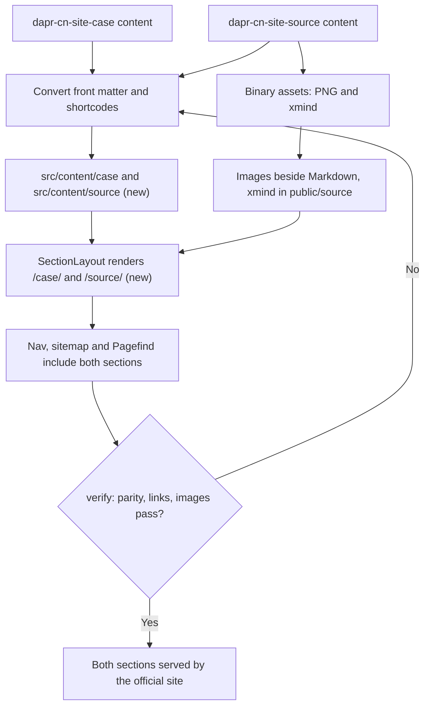

# Proposal

## Why

The Dapr Chinese community publishes two small Hugo/Docsy sites next to the official site: the user-case site (`dapr-cn-site-case`, served at `cn.dapr.io/case`) and the source-study site (`dapr-cn-site-source`, served at `cn.dapr.io/source`). The official site (`dapr-cn-site`, Astro 7 + Starlight) has already left Hugo and deliberately keeps both sections out of its build: the archived spec says they "SHALL NOT be produced as pages by this site", the navigation test asserts there is no link to them, and the link checker skips them. The result is three repositories, two Hugo toolchains and two deployments for roughly 26 KB of Markdown, a header with no way to reach either section, and no search or sitemap coverage for them. Moving the content into the official site makes `cn.dapr.io` one site again, with one build, one search index and one contribution path.

## Involved Repositories

| Repository Name | Path | Edit Permission | Purpose |
| --- | --- | --- | --- |
| dapr-cn-site | repos/dapr-cn-site | [editable] | Current change context |
| dapr-cn-site-case | repos/dapr-cn-site-case | [editable] | Current change context |
| dapr-cn-site-source | repos/dapr-cn-site-source | [editable] | Current change context |

## What Changes

- Convert the Hugo content of `dapr-cn-site-case` (7 pages) and `dapr-cn-site-source` (14 pages, 7 images, 2 `.xmind` files) into two new Astro content collections of the official site, `case` and `source`, keeping every old public URL (`/case/…`, `/source/…`).
- Add a shared section layout and two thin route files so each collection renders under its own URL prefix with a section sub-navigation, a breadcrumb, the 780px reading column and Pagefind indexing. The pages are community-authored, so they do not use the "translated from the official site" banner that the `site` collection prints.
- Rewrite what Hugo did and Astro does not: the `pageinfo` and `blocks/*` shortcodes become plain Markdown or the landing-page card list, `relref` becomes plain relative links, and the Hugo-only front matter (`menu`, `cascade`, `weight` as menu order) is dropped or mapped to a sort field.
- Rewrite the case submission pages (`join/pr`, `join/report`) so they point at `dapr-cn-site` (`src/content/case/…`, its issue tracker) instead of the old repository and Hugo.
- Keep the six body-less URLs (`/case/china/`, `/case/global/`, `/source/detail/{runtime,component,control-plane,sdk}/`) alive with one neutral placeholder sentence rather than a blank page or a 404.
- Restore 源码 and 案例 in the primary navigation in their original order, and include both sections in the sitemap and the Pagefind search.
- **BREAKING (rules, not URLs):** reverse the "served by separate sites" rule: remove `EXTERNAL_SECTIONS`, flip `tests/nav.test.ts`, update `PRODUCT.md`, and replace the archived requirement. No public URL changes.
- Point the READMEs of `dapr-cn-site-case` and `dapr-cn-site-source` at the new location. Their content stays in place; retiring the two repositories is a separate decision.

### Transfer flow


*Caption: both source sites feed one conversion step, and the sections count as transferred only when parity, link and image checks pass. Supports the What Changes section.*

### Interface prototype

Section page at desktop width (the existing masthead and footer frame it; no new colours, no shadows):

```
┌──────────────────────────────────────────────────────────────────────────┐
│ Dapr 中国社区  介绍 活动 博客 翻译 [源码] 会议 案例 出版 成员 了解 Dapr ▾ │
├──────────────────────────────────────────────────────────────────────────┤
│  首页 / 源码 / 参与活动 / 源码解读的方式                                  │
│                                                                          │
│  ┌ 本栏目 ────────┐   源码解读的方式                                    │
│  │ 我们的目标     │   Dapr 源码数量不少，为了有效的阅读和分工合作……     │
│  │ 源码解读的方式◀│                                                      │
│  │ 双周会         │   ## Dapr 代码的背景                                 │
│  │ 知识图谱       │   ### 按照构建块垂直划分                             │
│  │ 分工合作       │                     │
│  └────────────────┘                                                      │
│                                         [← 我们的目标]   [双周会 →]     │
└──────────────────────────────────────────────────────────────────────────┘
```

Landing page (`/case/`): a title, one lead sentence and two groups of three bordered cards, using the existing card geometry: reading (国内用户案例, 国外用户案例, 官网客户案例资料) and submitting (PR, 人工提交, 爆料). `/source/` has the same shape with 流程, 细节, 设计 and the three actions. Cards without a link render as plain cards. Below 960px the section list collapses above the article body.

## Capabilities

### New Capabilities
- `site-case-and-source-sections`: the `/case/` and `/source/` sections of the official site: which pages exist at which URLs, how body-less pages, binary assets and the submission instructions behave, and how the sections are attributed.

### Modified Capabilities
- `site-routing-and-url-parity`: the requirement "Source and case sections remain reachable" changes from "served elsewhere and never built here" to "served by this site at the same URLs".
- `site-home-and-navigation`: the primary navigation requirement lists 源码 and 案例 again, with the real link targets, in the original order.
- `site-search-and-feeds`: the search and sitemap requirements cover the case and source pages.
- `site-content-model`: the typed-collections requirement adds the `case` and `source` collections.

## Impact

- **Code (`dapr-cn-site`):** `src/content.config.ts`, a new layout and two route files, `src/lib/urls.ts`, `src/config/nav.ts`, `src/pages/sitemap.xml.ts`, and the checks in `scripts/verify-content.mjs`, `scripts/hugo-urls.txt` and `scripts/retired-urls.txt`. Tests in `tests/nav.test.ts` and `tests/verify-content.test.mjs` change, and a new section test is added.
- **Content:** about 21 new pages, 7 images and 2 downloads (about 1.5 MB) land in `dapr-cn-site`.
- **Header fit:** the desktop navigation goes from seven to nine community entries plus the 了解 Dapr group. The 1200px breakpoint may need to move, and the 360px mobile menu must stay usable.
- **Hosting (outside this repository):** the site deploys to Azure Static Web Apps and no routing file is in the repository. Any host-level rule that still sends `/case` or `/source` to the old deployments would shadow the new pages. This cannot be verified from the repository, and its owner has to confirm it before the sections are expected to serve.
- **Dependencies:** none. Astro's built-in image handling and the existing Pagefind setup are enough.
- **Out of scope:** deleting or archiving the two old repositories, redirects on the host, and any new case or study content.

### Code change table

| File Path | Change Type | Change Reason | Impact Scope |
|-----------|-------------|---------------|--------------|
| `repos/dapr-cn-site/src/content.config.ts` | Modify | Declare the `case` and `source` collections with a shared page schema and path-based ids | Content model |
| `repos/dapr-cn-site/src/content/case/**` | Add | Converted case pages (7 files) | Content |
| `repos/dapr-cn-site/src/content/source/**` | Add | Converted source pages (14 files) and 7 co-located PNG images | Content |
| `repos/dapr-cn-site/public/source/join/{knowledge-graph,workitems}/*.xmind` | Add | Keep the two download URLs unchanged | Static assets |
| `repos/dapr-cn-site/src/layouts/SectionLayout.astro` | Add | Breadcrumb, section sub-navigation, previous and next links, reading column | Rendering |
| `repos/dapr-cn-site/src/pages/case/[...id].astro` | Add | Route `/case/…` from the `case` collection | Routing |
| `repos/dapr-cn-site/src/pages/source/[...id].astro` | Add | Route `/source/…` from the `source` collection | Routing |
| `repos/dapr-cn-site/src/lib/urls.ts` | Modify | URL helpers for the two sections | Routing |
| `repos/dapr-cn-site/src/lib/sections.ts` | Add | Ordering, sibling list, breadcrumb and previous or next helpers | Rendering |
| `repos/dapr-cn-site/src/config/nav.ts` | Modify | Add 源码 and 案例 to the primary navigation | Header, footer |
| `repos/dapr-cn-site/src/components/Header.astro` | Modify (if needed) | Keep nine entries inside the desktop bar and the 360px menu | Header |
| `repos/dapr-cn-site/src/pages/sitemap.xml.ts` | Modify | List the new pages | Search and feeds |
| `repos/dapr-cn-site/scripts/verify-content.mjs` | Modify | Stop skipping `/source/` and `/case/`, load the new collections, resolve the root page base route | Verification |
| `repos/dapr-cn-site/scripts/hugo-urls.txt` | Modify | Add the 21 section URLs so parity protects them | Verification |
| `repos/dapr-cn-site/scripts/retired-urls.txt` | Modify | Map the two retired Hugo search URLs | Verification |
| `repos/dapr-cn-site/tests/nav.test.ts` | Modify | Expect nine entries and the two links | Tests |
| `repos/dapr-cn-site/tests/verify-content.test.mjs` | Modify | `/source/` is no longer an external section | Tests |
| `repos/dapr-cn-site/tests/sections.test.ts` | Add | Cover ids, ordering, breadcrumbs, previous and next | Tests |
| `repos/dapr-cn-site/README.md` | Modify | Document the two new content paths | Docs |
| `repos/dapr-cn-site/PRODUCT.md` | Modify | Remove the statement that the navigation never links to the two sections | Docs |
| `repos/dapr-cn-site-case/README.md` | Modify | Point to the new location and contribution path | Docs |
| `repos/dapr-cn-site-source/README.md` | Modify | Point to the new location and contribution path | Docs |
