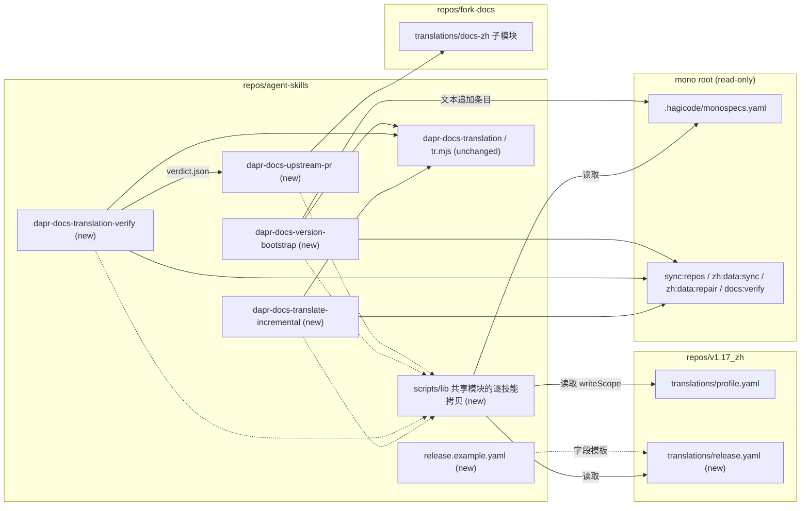
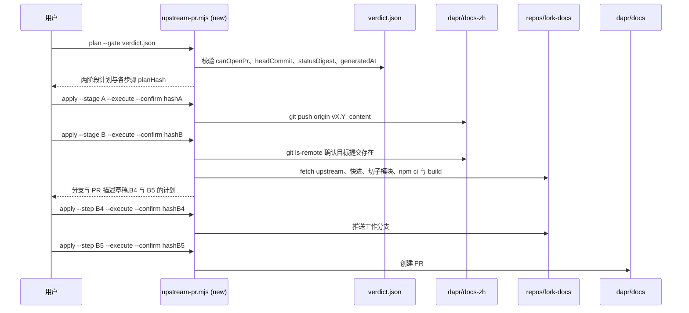
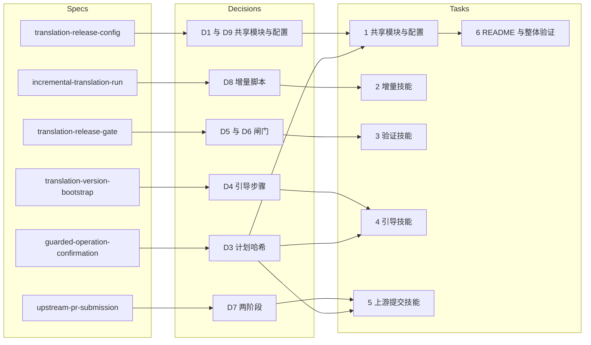

# Design

## Context

动机与范围见 `proposal.md`。与方案直接相关的现状:

- `repos/agent-skills` 目前只有 `dapr-docs-translation/`(引擎,`scripts/tr.mjs`、`lib/yaml.mjs` 等)和 `tests/dapr-docs-translation/`。`npm test` 是 `node --test "tests/**/*.test.mjs"`,新增 `tests/<skill>/*.test.mjs` 会被自动收录,`package.json` 不需要改。
- 引擎的 `lib/yaml.mjs` 只有解析器(`parseYaml`),没有写入器;`.hagicode/monospecs.yaml` 带有注释,需要文本级追加,不能整文件重写。
- mono 根的 `zh:data:sync`、`zh:data:repair`、`docs:verify` 已经接受 `--version` 等参数,只是默认值是 `v1.17`;`zh:data:repair` 的 `--repo` 默认值是 `../${version}_zh`,从 mono 根运行是错的。
- `sync:repos` 对 `optional: true` 且远端分支不可达的条目只会跳过,所以 `vX.Y_content` 在远端出现之前不会被克隆。
- `repos/v1.17_zh` 的远端就是 `dapr/docs-zh`,分支 `v1.17_content`;`repos/fork-docs` 只有 `origin`(`dapr-cn/fork-docs`),`translations/docs-zh` 子模块未初始化,`.gitmodules` 里记录的分支是 `v1.0_content`,README 没有 “Upstream pull requests through fork-docs” 一节。
- 引擎的 profile `writeScope` 为 `translations/` 与 `translated_content/`;`data/`、`site/`、`scripts/` 为只读;`data/` 只由 `zh:data:sync` 写。

## Goals / Non-Goals

**Goals:**

- 四个技能各有可测试的确定性脚本,把「算什么、按什么顺序、能不能做」从模型的判断里拿出来;模型只负责派发翻译 subagent 和解释结果。
- 所有版本相关的值由配置解析,脚本里没有字面的 `v1.17`(测试里的夹具除外)。
- 公开或不可逆的动作有统一、可测试的守卫。

**Non-Goals:**

- 不修改引擎、`profile.yaml` schema 和 mono 根的任何文件。
- 不实现 `release.yaml` 的自动改写(它是人工维护的)。
- 不自动处理 `data/` 的提交(见 D6)。
- 不生成对 `dapr/docs` 子模块 `.gitmodules` 分支字段的修改。

## Architecture

*Caption: 四个技能只通过各自的共享模块读取配置,引擎和根命令只被调用、不被修改;唯一写 monospecs 的是引导技能,唯一碰 fork-docs 的是上游提交技能。支撑 Decisions 一节。*

## Decisions

### D1 每个技能自带一份共享模块,用测试保证一致

四个技能都需要 YAML 解析、配置解析、确认守卫和 git 辅助。放进共享目录会让技能无法单独安装,跨技能 import 会让它们相互依赖。决定:每个技能在自己的 `scripts/lib/` 里带需要的拷贝(`yaml.mjs`、`config.mjs`、`guard.mjs`、`git.mjs`,按需),另加 `tests/shared-lib-sync.test.mjs` 断言同名文件内容逐字相同。`yaml.mjs` 以引擎现有的解析器为底本拷贝,不改引擎本身。

备选:① 跨技能 import 引擎的 `yaml.mjs`,拒绝,因为技能要能单独安装;② 顶层 `_shared/` 文件夹,拒绝,因为 README 约定每个顶层文件夹都是带 `SKILL.md` 的技能。代价:改共享模块要同步多处,由一致性测试兜底。

### D2 脚本契约:纯函数加薄 CLI

每个技能一个入口(`incremental.mjs`、`gate.mjs`、`bootstrap.mjs`、`upstream-pr.mjs`),子命令如 `plan`、`run`、`apply`。业务逻辑是导出的纯函数,命令执行、文件系统和时钟通过可注入的参数传入,CLI 只在 `import.meta.url` 是入口时运行。输出一律 JSON(`--json`)或人类可读摘要。退出码:`0` 成功;`1` 检查未通过或前置条件被拒;`2` 用法或配置错误;`3` 确认值不匹配。这样分支探测、计划生成、闸门判定和「dry-run 不写文件」都能在临时目录里不联网测试。

### D3 确认守卫:计划哈希

`plan` 输出每个步骤的 `id`、`kind`(`local-write` / `branch-create` / `public-push` / `public-pr` / `read`)、命令与目标,并为每个非 `read` 步骤给出 `planHash = sha256(规范化JSON{stepId, remote url, branch, 目标提交, 命令})`。`apply --step <id> --execute --confirm <hash>` 先按当前仓库状态重算,不等就退出 3。这使得:确认只对看过的那一份计划有效、不能跨步骤复用、仓库状态一变就失效。脚本不读取环境变量、台账或配置里的任何「已确认」标记。这个机制只能保证确认值与计划匹配,不能证明是谁输入的;`SKILL.md` 里要求模型把计划原样展示给用户并只接受用户在当次对话中给出的确认。

### D4 引导:从上一版 `_content` 分支切出新分支,而不是拷文件或 adopt

要带入的东西(`translations/` 的台账与术语表、基线源文副本、`translated_content/`)恰好都在上一版分支里,由它切出新分支可以一次带全,并保留历史。步骤为:

| 步骤 | 类型 | 内容 |
| --- | --- | --- |
| S0 | read | `git ls-remote --heads` 探测上游与翻译分支,确定上一版 |
| S1 | local-write | 克隆 `repos/vX.Y`(分支 `vX.Y`),URL 取自上一版的 monospecs 条目 |
| S2 | local-write | 克隆 `repos/vX.Y_zh`,检出上一版 `_content` 分支 |
| S3 | branch-create | 在 `repos/vX.Y_zh` 里 `git switch -c vX.Y_content` |
| S4 | local-write | 在 `.hagicode/monospecs.yaml` 追加两个 `optional: true` 条目(文本追加,保留注释) |
| S5 | local-write | 更新 `profile.yaml` 的版本相关字段,生成 `release.yaml`,`git commit -- translations/profile.yaml translations/release.yaml` |
| S6 | read | `zh:data:sync`、`scan --json`,报告 fresh / stale / new |
| S7 | public-push | 可选;默认由 `dapr-docs-upstream-pr` 阶段 A 负责 |

备选:① 拷贝 `translations/` 到全新克隆,拒绝,因为会丢掉 `translated_content/` 与历史,`scan` 无法判断 `stale`;② `tr.mjs adopt`,按需求明确排除,因为被采纳的文档没有基线副本。每个步骤可独立重跑:已完成的步骤在计划里标 `done`。

### D5 闸门:前后快照、失败即关闭

`gate.mjs run` 通过可注入的 `exec` 运行三条命令,运行前后各取一次 `git status --porcelain=v1 -z` 的快照。判定规则是纯函数 `decide(inputs)`:任何检查没有得到退出码、任何非零退出、`fail` 或 `blocked` 的路径、前后快照不一致,都使 `canOpenPr` 为 false。输出包含 `headCommit`、`statusDigest`(排序后的快照哈希)、`generatedAt`。

### D6 `data/` 的处理:`syncOutputPaths` 加 `blocked`

`zh:data:sync` 会改 `data/`,而增量技能只能提交 `translations/` 与 `translated_content/`。严格按「脏文件必须在 `writeScope` 内」,源文一变闸门就永远过不了。决定:`release.yaml` 声明 `syncOutputPaths: [data/]`;闸门对这类路径给出 `blocked`(原因:同步产物需单独人工提交),不当作越界,但也不放行;增量技能结束时在摘要里提示。备选:① 增量技能也提交 `data/`,违反「只提交 writeScope」;② 闸门对 `data/` 只告警,PR 可能带着未提交的源文索引。这一项在探索阶段提给了用户,当时没有得到回复,先按上述默认值实现。

### D7 上游提交:闸门结论作为文件传入,两阶段拆成可单独确认的步骤

`upstream-pr.mjs plan --gate <verdict.json>` 校验新鲜度(`headCommit` 一致、`statusDigest` 一致、`generatedAt` 在 `--max-age-minutes` 内,默认 30)。步骤:

| 步骤 | 类型 | 内容 |
| --- | --- | --- |
| A1 | public-push | 普通 `git push <zh 远端> vX.Y_content`,不用 `--force` |
| A2 | public-pr | 可选;为 `dapr/docs-zh` 创建 PR |
| B1 | local-write | 确认 `repos/fork-docs` 有指向 `dapr/docs` 的 remote(没有就按 `release.yaml` 的 `upstreamUrl` 添加),`git fetch` 后只允许快进 |
| B2 | branch-create | 在 `repos/fork-docs` 建工作分支,把 `translations/docs-zh` 子模块切到 A1 推送的提交,用 `git commit -- translations/docs-zh` 提交 |
| B3 | local-write | `npm ci && npm run build` |
| B4 | public-push | 推送 fork-docs 的工作分支 |
| B5 | public-pr | 创建面向 `dapr/docs` 的 PR |

阶段 A 与阶段 B 各有一个确认值;B1 到 B3 共用阶段 B 的本地确认,B4、B5 各自单独确认。阶段 B 开始前用 `git ls-remote` 检查目标提交已在 `dapr/docs-zh` 上。「准备 PR」解释为 B1 到 B3 加上 PR 标题与描述草稿(写入调用方给的 `--out` 目录),而不包括推送和创建。fork-docs 的 README 没有该小节,所以这几步由技能自己定义。

*Caption: 每一次推送或建 PR 之前都有一次用户给出的、与计划哈希匹配的确认;阶段 B 只有在阶段 A 的提交已经存在于远端之后才会开始。支撑 D3 与 D7。*

### D8 增量技能:脚本做确定性部分,引擎工作流由主会话驱动

翻译引擎工作流(`next`、subagent 翻译、`check`、`finalize`)由主会话按 `dapr-docs-translation/SKILL.md` 驱动,不是脚本能执行的。所以 `incremental.mjs` 提供 `plan`(五步,其中第 4 步标 `kind: agent`,指向引擎技能)、`run --phase pre`(步骤 1 到 3,遇到失败停止)、`run --phase post`(步骤 5)和 `commit`(只提交 `translations/` 与 `translated_content/` 下有改动的路径,用 `git commit -- <path>`,无改动不提交)。`--source-root` 由 profile 的 `sources.glob.root` 解析得出。

### D9 配置解析与 release.yaml

`config.mjs` 向上查找 `.hagicode/monospecs.yaml` 得到 mono 根;解析版本时按「参数 > `release.yaml` > 缺失即报错」;仓库路径默认 `repos/<version>` 与 `repos/<version>_zh`,但优先取 monospecs 里的条目;URL 与分支只取 monospecs。`release.yaml` 只放 monospecs 里没有的人工信息:`version`、`previousVersion`(可选)、`syncOutputPaths`、`upstreamPr.forkDocs.{path, submodulePath, upstreamUrl, upstreamBranch}`。`schema: 1`。不动 `profile.yaml`。

### D10 一份 v1.17 的 `release.yaml`

`repos/v1.17_zh/translations/release.yaml` 按模板填写 v1.17 的值(`version: v1.17`、`syncOutputPaths: [data/]`、fork-docs 路径与 `dapr/docs` 的 `v1.17` 分支)。它位于 `writeScope` 内。实现时要在添加前后各跑一次 `scan --json` 确认计数不变(spec: 额外文件不影响翻译引擎)。

## 代码变更清单

| File Path | Change Type | Change Description | Affected Module |
|-----------|-------------|-------------------|-----------------|
| `repos/agent-skills/dapr-docs-translate-incremental/SKILL.md` | 新增 | 触发场景、输入、五步流程、规则与脚本用法 | 增量技能 |
| `repos/agent-skills/dapr-docs-translate-incremental/scripts/incremental.mjs` | 新增 | `plan`、`run --phase pre/post`、`commit` | 增量技能 |
| `repos/agent-skills/dapr-docs-translation-verify/SKILL.md`、`scripts/gate.mjs` | 新增 | 闸门判定、范围检查、verdict 输出 | 验证技能 |
| `repos/agent-skills/dapr-docs-version-bootstrap/SKILL.md`、`scripts/bootstrap.mjs`、`scripts/branches.mjs`、`scripts/monospecs-edit.mjs` | 新增 | 分支探测、monospecs 文本追加、步骤计划、profile 更新 | 引导技能 |
| `repos/agent-skills/dapr-docs-upstream-pr/SKILL.md`、`scripts/upstream-pr.mjs` | 新增 | 闸门校验、两阶段计划、受确认保护的执行 | 上游提交技能 |
| `repos/agent-skills/<skill>/scripts/lib/{yaml,config,guard,git}.mjs`(按需) | 新增 | 各技能自带的共享模块拷贝 | 四个技能 |
| `repos/agent-skills/tests/dapr-docs-translate-incremental/*.test.mjs` | 新增 | 计划顺序、失败即停、提交范围、dry-run 不写、无被禁命令 | 测试 |
| `repos/agent-skills/tests/dapr-docs-translation-verify/*.test.mjs` | 新增 | `decide` 的判定矩阵、范围分类、只读快照、fail-closed | 测试 |
| `repos/agent-skills/tests/dapr-docs-version-bootstrap/*.test.mjs` | 新增 | 分支探测与排序、上一版选择、monospecs 追加与幂等、步骤计划、dry-run 不写 | 测试 |
| `repos/agent-skills/tests/dapr-docs-upstream-pr/*.test.mjs` | 新增 | 闸门新鲜度、计划哈希、确认不匹配被拒、阶段顺序、不强推 | 测试 |
| `repos/agent-skills/tests/shared-lib-sync.test.mjs`、`tests/config.test.mjs` | 新增 | 共享模块拷贝一致;配置解析与 `release.example.yaml` 校验 | 测试 |
| `repos/agent-skills/release.example.yaml` | 新增 | 逐字段注释的模板 | 模板 |
| `repos/agent-skills/README.md` | 修改 | 技能表新增四行 | 文档 |
| `repos/v1.17_zh/translations/release.yaml` | 新增 | v1.17 的发布配置 | v1.17_zh |

## 需求到决策到任务的追溯

*Caption: 每个 spec 都经过一个决策到达一个任务组;守卫(D3)同时落到引导与上游提交两个技能。支撑 tasks.md 的分组。*

## Risks / Trade-offs

- [共享模块拷贝漂移] → `shared-lib-sync.test.mjs` 断言同名文件逐字相同,改一处必须改全部。
- [确认哈希只证明匹配、不证明是谁给的] → `SKILL.md` 要求原样展示计划并只接受当次对话中用户给出的确认;脚本不读取任何持久化的「已确认」标记。
- [`data/` 脏会让闸门长期 `blocked`] → D6 的 `syncOutputPaths` 让原因明确;是否改为由增量技能另提交,留给用户后续决定。
- [`tr.mjs status --verify` 需要 `--source-root`] → 由 profile 的 `sources.glob.root` 解析;实现时用 v1.17 实际数据核对,必要时改传适配器的 `_meta.sourceRoot`。
- [`zh:data:repair --mode audit` 是否真的只读未验证] → 闸门的前后快照会发现它写了文件并判为 `blocked`。
- [`fork-docs` 里没有 upstream remote,`.gitmodules` 的分支字段是 `v1.0_content`] → B1 负责补 remote;`.gitmodules` 不改,切换的是子模块指向的提交。
- [`sync:repos` 不会克隆远端尚不存在的 `vX.Y_content`] → 引导技能自己克隆与建分支,登记 monospecs 后 `sync:repos` 才接管。
- [构建依赖 Hugo 与网络] → B3 失败只停在本地,不推送;`SKILL.md` 里列出前置工具。

## Open Questions

- `previousVersion` 是否应该由人在 `release.yaml` 里固定,还是总由分支探测决定?当前实现:`release.yaml` 里写了就以它为准,没写就探测;不影响 spec 与任务拆分。
- 是否要在 PR 描述里自动附上 `scan` 的数量摘要?可以在实现完成后再加。
