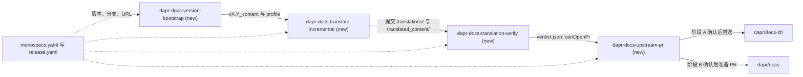

# Proposal

## Why

`dapr-docs-translation` 引擎(`tr.mjs scan/next/check/finalize/adopt/status`)只负责单篇文档级的翻译,而「新版本引导、日常增量翻译、发布前检查、向上游提交」这四段流程目前靠人工记忆和零散命令完成:版本号、分支和 URL 被写在各条命令的默认值里(根仓库的 `zh:data:sync`、`zh:data:repair`、`docs:verify` 默认都是 `v1.17`),公开或不可逆的操作(推送、建 PR)也没有统一的确认约束。上游 `dapr/docs` 已经有 `v1.18` 到 `v1.20` 分支,而 `dapr/docs-zh` 只有到 `v1.17_content`,现在需要一套随版本配置驱动、能复用到下一个版本的编排技能。

## What Changes

- 在 `repos/agent-skills` 新增四个顶层技能文件夹,各含 `SKILL.md`(frontmatter `name` 与文件夹同名,`description` 写明触发场景)、仅用 Node 内置模块的 `.mjs` 确定性脚本,以及 `tests/<skill>/` 下的单元测试:
  - `dapr-docs-translate-incremental`:依次执行 `pnpm run sync:repos`、`pnpm run zh:data:sync`、`tr.mjs scan`、翻译引擎流程、`tr.mjs status`,最后只用 `git commit -- <path>` 提交 `translations/` 与 `translated_content/`;不推送、不建分支。
  - `dapr-docs-translation-verify`:只读闸门,运行 `tr.mjs status --verify --fail-on stale,failed,blocked,orphan,drift,glossary`、`zh:data:repair --mode audit`、`docs:verify --dry-run`,检查未提交与已暂存内容是否都在 profile 的 `writeScope` 内,给出「能否开 PR」的结论。
  - `dapr-docs-version-bootstrap`:引导新的 `vX.Y`。探测上游分支;把 `repos/vX.Y` 与 `repos/vX.Y_zh` 作为 optional 仓库(分支 `vX.Y_content`)登记进 `.hagicode/monospecs.yaml`;从上一版 `_content` 分支带入译文、台账、术语表和基线副本;写新的 profile。不使用 `adopt`。随后运行 `zh:data:sync` 与 `scan`,报告 fresh / stale / new 的数量。默认 dry-run,建分支和推送逐步确认。
  - `dapr-docs-upstream-pr`:要求验证闸门通过;默认只出计划;分两个单独确认的阶段执行。阶段 A 把 `vX.Y_content` 推到 `dapr/docs-zh`;阶段 B 在 `repos/fork-docs` 快进 upstream、把 `translations/docs-zh` 子模块切到目标提交、执行 `npm ci && npm run build`,并准备面向 `dapr/docs` 的 PR。
- 新增 `repos/agent-skills/release.example.yaml` 模板,以及实际的 `repos/v1.17_zh/translations/release.yaml`(人工维护,不改 `profile.yaml` 的 schema)。
- 在 `repos/agent-skills/README.md` 的技能表里为四个新技能各加一行。
- 公开或不可逆操作(推送、建 PR)一律默认 dry-run,且必须在当次调用中显式确认;历史记录和此前的授权不算确认。
- 技能不写死任何仓库事实:版本、分支、URL 取自命令参数、`.hagicode/monospecs.yaml` 和 `translations/release.yaml`,代码里不出现硬编码的 `v1.17`。
- 现有 `dapr-docs-translation` 的文件与测试保持不变(无 **BREAKING** 变更)。

### 探索中确认的事实(影响方案)

- 根仓库三条命令已经支持显式参数(`--version`、`--source-repo`、`--zh-repo`、`--repo`、`--mode`、`--dry-run`),只是默认值是 `v1.17`。所以技能每次显式传参即可,根仓库的参数化改造不阻塞本提案。注意 `zh:data:repair` 的 `--repo` 默认值是 `../${version}_zh`,从 mono 根运行会指向仓库之外,必须显式传 `--repo repos/vX.Y_zh`。
- `sync:repos` 对 `optional: true` 且远端分支不可达的条目只会跳过。新版本的 `vX.Y_content` 在远端出现之前,`sync:repos` 不会克隆 `repos/vX.Y_zh`,因此引导技能必须自己完成克隆和建分支。
- `dapr/docs-zh` 同时有旧的 `new_content_vX.Y`(≤ v1.6)和 `vX.Y_content`;上游分支有 `v1.2`、`v1.13`、`v1.20`,分支探测必须只匹配 `^v(\d+)\.(\d+)_content$` 并按数字排序。
- `repos/fork-docs/README.md` 里没有 “Upstream pull requests through fork-docs” 这一节,只有 5 步的 “Update docs”。阶段 B 的四步由技能自己写明(快进 upstream、切子模块、`npm ci && npm run build`、准备 PR),不依赖该 README 的文字。
- 验证闸门要求脏文件都在 `writeScope` 内,但 `zh:data:sync` 会改 `data/`,而增量技能只提交 `translations/` 与 `translated_content/`。本提案的默认处理:`release.yaml` 增加 `syncOutputPaths: [data/]`;闸门遇到这些路径的改动给出 `blocked`(原因:同步产物需单独人工提交),既不当作越界,也不放行。

*Caption: 四个技能按引导、增量、闸门、上游提交的顺序衔接,版本相关的值只来自配置,公开操作只出现在最后的两个阶段(以及引导中需单独确认的建分支步骤)。支撑 What Changes 一节。*

## Capabilities

### New Capabilities

- `translation-release-config`: 各技能如何从 `.hagicode/monospecs.yaml`、`translations/release.yaml` 与命令参数得到版本、分支、URL,拒绝硬编码版本;`release.example.yaml` 模板与 v1.17 实例的字段约定。
- `guarded-operation-confirmation`: 公开或不可逆操作默认 dry-run,只有当次调用里显式给出与当前计划匹配的确认才执行;历史记录与旧授权无效;写入范围受 `writeScope` 约束。
- `incremental-translation-run`: 日常增量翻译的编排顺序、只提交 `translations/` 与 `translated_content/`、不推送不建分支。
- `translation-release-gate`: 只读的发布前闸门:三项检查、写入范围检查、`canOpenPr` 判定及原因。
- `translation-version-bootstrap`: 新 `vX.Y` 的分支探测、monospecs 登记、从上一版 `_content` 分支带入状态、新 profile、统计报告,默认 dry-run 与逐步确认。
- `upstream-pr-submission`: 向 `dapr/docs-zh` 与 `dapr/docs` 提交的两阶段流程、闸门前置条件、默认只出计划。

### Modified Capabilities

无。现有的 `zh-translation-skill-workspace` 等根仓库 spec 不改;根仓库的参数化是单独的后续提案。

## Involved Repositories

No confirmed repository scope is specified for this change.

## 代码变更表

| File Path | Change Type | Change Reason | Impact Scope |
|-----------|-------------|---------------|--------------|
| `repos/agent-skills/dapr-docs-translate-incremental/` (`SKILL.md`, `scripts/*.mjs`, `scripts/lib/*.mjs`) | 新增 | 增量翻译编排 | 新技能,调用引擎但不改引擎 |
| `repos/agent-skills/dapr-docs-translation-verify/` | 新增 | 只读发布闸门 | 新技能 |
| `repos/agent-skills/dapr-docs-version-bootstrap/` | 新增 | 新版本引导 | 新技能;会写 monospecs 与新版本仓库(需确认) |
| `repos/agent-skills/dapr-docs-upstream-pr/` | 新增 | 两阶段上游提交 | 新技能;会推送与建 PR(需确认) |
| `repos/agent-skills/tests/dapr-docs-translate-incremental/`、`tests/dapr-docs-translation-verify/`、`tests/dapr-docs-version-bootstrap/`、`tests/dapr-docs-upstream-pr/` | 新增 | 分支探测、计划生成、闸门判定、dry-run 不写文件的单测 | `npm test` |
| `repos/agent-skills/release.example.yaml` | 新增 | `release.yaml` 模板 | 文档与模板 |
| `repos/agent-skills/README.md` | 修改 | 技能表新增四行 | 文档 |
| `repos/v1.17_zh/translations/release.yaml` | 新增 | v1.17 的人工维护发布配置 | 位于 `writeScope`(`translations/`)内;需确认引擎的 `scan` / `status` 不受额外文件影响 |
| `repos/agent-skills/dapr-docs-translation/**`、`tests/dapr-docs-translation/**`、`package.json` | 不变 | 引擎必须保持不变;`npm test` 的 glob 已覆盖新增测试 | 回归保护 |

## Impact

- **代码**:只新增技能、脚本、测试、模板和一份 `release.yaml`,另在 `README.md` 加四行;没有对引擎代码、`profile.yaml` schema 或根仓库脚本的修改。
- **依赖**:脚本只用 Node 内置模块。四个技能共用的小模块(YAML 解析、配置读取、确认守卫、git 辅助)各带一份拷贝,由一条测试断言各份内容一致,以便每个技能能单独安装。
- **运行时依赖**:调用 mono 根的 `pnpm run sync:repos`、`zh:data:sync`、`zh:data:repair`、`docs:verify`,以及 `repos/fork-docs` 里的 `npm ci && npm run build`(需要 Hugo)。
- **范围外**:根仓库的 `zh:data:sync` / `zh:data:repair` / `docs:verify` 默认值参数化、根 README 的 “Translate with the skill” 小节、仓库角色表、`.hagicode/monospecs.yaml` 与 `scripts/` 的相关改动,留给单独的后续提案;在那之前技能从参数或 `release.yaml` 取版本,不写死 `v1.17`。
