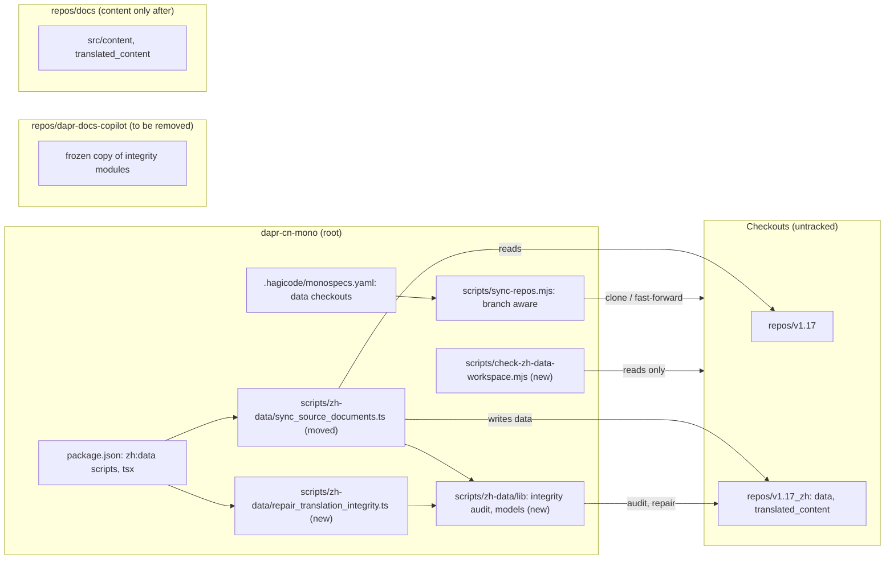
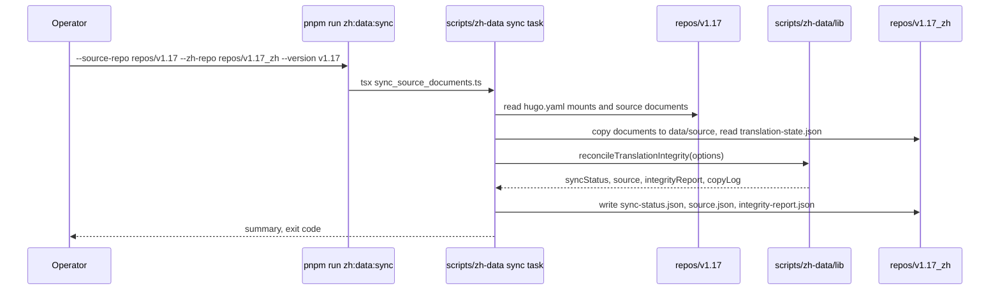
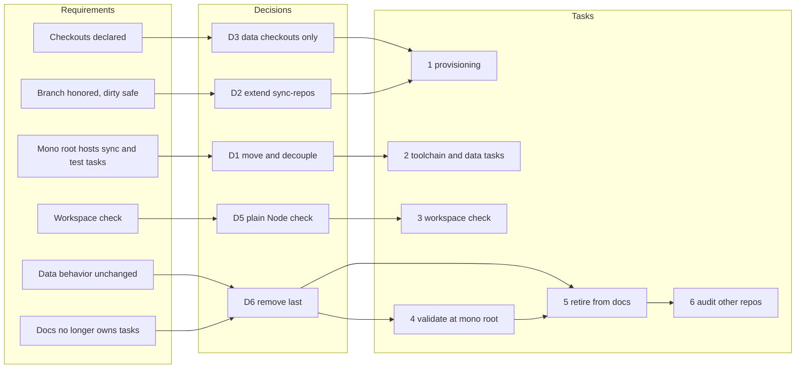

# Design

## Context

See `proposal.md` (Why) for motivation and the scope narrowing: the copilot will be removed later, so only the key data part migrates. Findings from reading the repositories:

- The data task layer in `docs` is `package.json` (`zh:data:sync`, `zh:data:test`, `clone:repos`), `scripts/zh-data/sync_source_documents.ts` plus its test, `scripts/clone-repos.mjs` (reads `monospecs.yaml`, supports `branch` and `optional`) and `monospecs.yaml`.
- `sync_source_documents.ts` copies source documents into `repos/<version>_zh/data/source/**` and writes `sync-status.json`, `source.json`, `glossary.json`, `integrity-report.json` and the copy log. It computes the translated state through `reconcileTranslationIntegrity`.
- That function and its types come from `repos/dapr-docs-copilot/src/server/translation-integrity-audit.ts` (about 1,060 lines) and `src/lib/translation-integrity-models.ts` (about 240 lines). They import only Node built-ins and each other. The sync script's only copilot imports are these two files.
- `scripts/repair-translation-integrity.ts` (50 lines) is a command wrapper over the same audit module, with no other imports.
- Everything else in the copilot depends on copilot-only code or on the layout `<root>/repos/...`: the workbench admin, alias backfill, output validation, PR workbench and verification site. The pipeline integrity test imports the workbench admin, so it is not data-only.
- The mono root has `pnpm`, `js-yaml`, `scripts/sync-repos.mjs` (no `branch`/`optional`), a ten-entry `.hagicode/monospecs.yaml` without versioned checkouts, and `openspec/specs/zh-*` for the workbench.
- `repos/docs` has a clean tree on `main`.

## Goals / Non-Goals

**Goals:**
- Run dataset sync, integrity audit and repair from the mono root with no import from `repos/dapr-docs-copilot`.
- Provision the checkouts the data task reads and writes through the mono root's existing sync tool, preserving its dirty-tree safety.
- Make precondition failures diagnosable before a task runs.
- Leave `docs` with content only, removing its task entry points only after the mono root is proven.

**Non-Goals:**
- Any change in `repos/dapr-docs-copilot`, including its README, scripts and endpoints.
- Supporting the copilot UI, translation execution, output validation, alias normalization, PR workbench or local verification site from the mono root.
- Fork checkouts (`fork-docs` is left as is; `fork-v1.x` is not declared).
- Changing dataset shapes, translated content or Crowdin workflows.

## Architecture

*Caption: the mono root owns the data task, its integrity logic and the checkouts; the copilot is no longer on any dependency path and `docs` keeps only content. Supports Decisions D1 to D3.*

### Data sync call sequence

*Caption: the sync task reaches the integrity logic only through the local `lib` module, and datasets are written only into the zh checkout. Supports D1.*

## Decisions

### D1. Move the sync task and decouple it by copying the integrity modules
Move `scripts/zh-data/**` to the mono root, copy the two integrity modules (and the repair entry) to `scripts/zh-data/lib/` byte for byte, and change only the two import lines of the sync script. The copies must be identical at copy time, which makes behavior parity checkable with `cmp` and by running both versions on the same input.
- Alternative: keep the `../../repos/dapr-docs-copilot/...` imports. It works today but ties the data task to a repository that will be removed.
- Alternative: rewrite or trim the 1,060-line audit module. It risks changing dataset results and is not needed for the move.
- After migration the mono copy is the source of truth; the copilot copy is frozen.

### D2. Extend `sync-repos.mjs` instead of porting `clone-repos.mjs`
Add `branch` and `optional` support to the existing tool: clone with `--branch`, switch a clean existing checkout to the declared branch (tracking `origin/<branch>` when no local branch exists), keep `fetch --prune` plus `pull --ff-only`, keep the dirty-tree skip, and report a diverged or unreachable required entry as failed. Entries without `branch` behave exactly as today.
- Alternative: run `docs/scripts/clone-repos.mjs` from the mono root. It keeps two clone systems and fetches into dirty trees, which can disturb in-progress translations.

### D3. Declare only data checkouts, no fork checkouts
Declare `v1.17` and `v1.17_zh` as required and `v1.15` and `v1.15_zh` as `optional: true`, copying URL and `branch` from `docs/monospecs.yaml`. `fork-v1.15` and `fork-v1.17` serve only the PR workbench and are not declared. `repos/fork-docs` stays one separate checkout.
- Alternative: declare the full six-entry set from `docs`. It adds clones nothing in the migrated scope reads.

### D4. Toolchain at the mono root, installed with pnpm
`tsx`, `typescript` and `@types/node` become root dev dependencies, matching `docs`' toolchain for the same scripts. The sync script runs without a `tsconfig`, as it did in `docs`.

### D5. The workspace check is plain Node ESM with no dependency on `tsx`
`scripts/check-zh-data-workspace.mjs` uses only Node built-ins and `js-yaml` (already installed) so it can run and report when `tsx` itself is missing. It reads `.hagicode/monospecs.yaml`, the root `package.json` and the `repos/` tree, writes nothing, and exits non-zero with one line per unmet precondition and the provisioning command (`pnpm install` or `pnpm run sync:repos`). The v1.15 set is reported as information only.

### D6. Add first, verify, remove last
Order: provisioning, toolchain, copied and moved tasks, check script, validation at the mono root, then removal from `docs`. At every point at least one root can run `zh:data:sync`.

### D7. Transition of ongoing work
`repos/docs` has no uncommitted or in-flight task work. Before removing its entry points, any local branch that edits `repos/docs/scripts/zh-data/**` is moved to the mono root path. Edits to integrity logic made after migration go to the mono copy only. The copilot is neither migrated nor edited; its removal is a separate change.

## Detailed Code Change Inventory

| File Path | Change Type | Change Description | Affected Module |
|-----------|-------------|-------------------|-----------------|
| `.hagicode/monospecs.yaml` | Modify | Append four entries (`v1.17`, `v1.17_zh` required; `v1.15`, `v1.15_zh` optional) with `branch`; keep the ten existing entries | Provisioning |
| `scripts/sync-repos.mjs` | Modify | Branch-aware clone and switch, `optional` handling, diverged-entry failure; unchanged without `branch` | Provisioning |
| `scripts/tests/sync-repos.test.mjs` | Add | `node:test` cases over temporary git repositories: clone on branch, dirty skip, fast-forward, diverged failure, optional skip | Provisioning validation |
| `package.json` | Modify | Scripts `zh:data:sync`, `zh:data:test`, `zh:data:repair`, `zh:data:check`, `sync:repos:test`; dev dependencies `tsx`, `typescript`, `@types/node` | Toolchain |
| `pnpm-lock.yaml` | Modify | Lock new dev dependencies | Toolchain |
| `scripts/zh-data/lib/translation-integrity-audit.ts` | Add | Byte copy of the copilot module | Integrity reconciliation |
| `scripts/zh-data/lib/translation-integrity-models.ts` | Add | Byte copy of the copilot module | Integrity reconciliation |
| `scripts/zh-data/sync_source_documents.ts` | Add | Copy of the `docs` file with the two import lines pointing at `./lib/...` | Data sync |
| `scripts/zh-data/tests/test_sync_source_documents.ts` | Add | Verbatim copy of the `docs` test | Data sync |
| `scripts/zh-data/repair_translation_integrity.ts` | Add | Copy of the copilot entry with its import pointing at `./lib/...` | Integrity repair |
| `scripts/check-zh-data-workspace.mjs` | Add | Read-only precondition check (D5) | Diagnostics |
| `README.md` | Modify | Document data tasks, checkout set, check command | Operator docs |
| `repos/docs/scripts/zh-data/**` | Delete | After validation | `docs` |
| `repos/docs/scripts/clone-repos.mjs` | Delete | After validation | `docs` |
| `repos/docs/monospecs.yaml` | Delete | After validation | `docs` |
| `repos/docs/package.json`, `package-lock.json` | Modify | Remove retired scripts and unused dependencies; refresh lock | `docs` |
| `repos/docs/README.md` | Modify | "源码同步" points at the mono root | `docs` docs |
| `repos/docs/SRC_TRANSLATION_BUILD_ANALYSIS.md` | Modify | Update references to removed scripts and root | `docs` docs |
| `repos/dapr-docs-copilot/**` | No change | Out of scope; to be removed later | None |
| `repos/fork-docs`, `dapr-cn-site`, `dapr-cn-site-case`, `dapr-cn-site-source`, `dapr-cn.github.io`, `docs-team`, `docsy`, `wowchemy-hugo-themes` | Verify | Search for references to the old root, record "no change" | Audit only |

## Traceability

*Caption: every retained requirement reaches a decision and a task group, and retirement waits on validation. Supports the Traceability section.*

## Risks / Trade-offs

- [The spec deltas still contain copilot-facing requirements that this scope narrowing supersedes] → The affected parts are: in `translation-workbench-workspace`, "Workbench resolves its workspace root to the mono root" and the copilot-suite scenario of "Workbench behavior is unchanged by the relocation"; in `workbench-checkout-provisioning`, "Fork checkouts are separate from the single fork-docs checkout", and the `fork-*` and `v1.15` required-versus-optional entries in "Required checkouts are declared" (this design declares four data checkouts, two of them optional). Reconcile them before implementation starts; tasks.md reflects the narrowed scope and is authoritative until then.
- [Duplicated integrity modules drift between the mono root and the copilot] → The copilot copy is frozen and the copilot is being removed; task 2.2 records that the copies are identical at copy time.
- [Copying changes dataset output] → Task 4.2 compares `zh:data:sync` output from the `docs` root and the mono root on the same inputs; only timestamp fields may differ.
- [A dirty `repos/v1.17_zh` is skipped by provisioning, leaving a stale checkout] → The check script reports clean or dirty status as information; operators commit or stash before syncing, as the existing mono tool already requires.
- [Removing `docs` entry points breaks someone's habit or script] → Retirement is the last implementation step, the README names the replacement, and the change is flagged **BREAKING** in the proposal.
- [Unused-dependency removal in `docs` breaks a hidden consumer] → Task 5.1 searches `repos/docs` for each dependency before removal and keeps any that is still referenced.
- [The v1.15 set is optional, so a stale v1.15 checkout goes unnoticed] → Only the v1.17 set is required by the check; v1.15 is reported as informational.

## Migration Plan

1. Declare the four data checkouts and extend `sync-repos.mjs`; run its tests.
2. Add the toolchain and scripts to the mono `package.json`; copy the integrity modules; move the sync script and test with repointed imports; run `zh:data:test`.
3. Add the workspace check; run it against a deliberately incomplete and a complete workspace.
4. Provision checkouts; run `zh:data:test`, the check, and a sync-parity comparison against the `docs` root.
5. Remove the retired entry points and update the READMEs and analysis note in `docs`; rerun the step 4 validation.
6. Search the remaining repositories for the old root and record results.

Rollback: before step 5 nothing in `docs` has changed, so rollback is deleting the mono-root additions. After step 5, restoring the `docs` files from its history and removing the mono-root tasks reverts the change; no data or content is affected.

## Open Questions

- Should `zh:data:repair` be kept once the copilot is removed, or folded into `zh:data:sync`? Deferrable; it does not change the specs or tasks here.
