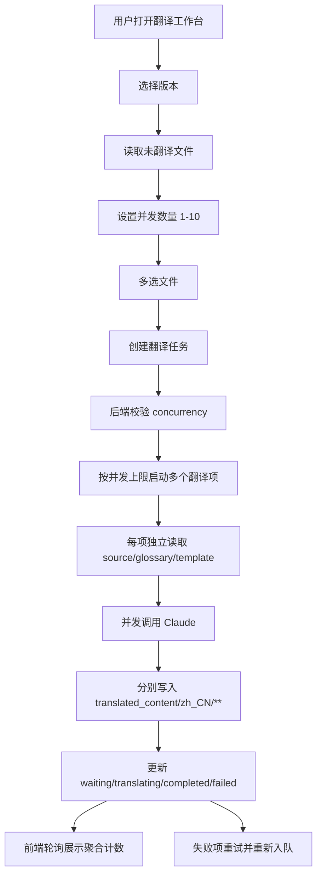

# zh-translation-workbench

## Purpose

提供交互式翻译工作台，支持版本选择、文件队列管理、有界并发翻译执行与状态观察。

## Capability Model

## Requirement Matrix

| Requirement | 说明 | 场景数 |
| --- | --- | --- |
| Workbench lists versions and untranslated files | 工作台须发现版本并展示未翻译文件基础信息 | 3 |
| User can enqueue multiple files for translation | 建任务时须同时携带选中文件与并发配置 | 2 |
| Translation templates are file-backed Handlebars assets | 提示词模板须独立保存为 `.hbs` 文件 | 2 |
| Glossary is injected into every translation request | 每次翻译须系统化引用术语表 | 2 |
| Successful translations reconcile downstream datasets | 工作台成功翻译后须立即闭环回写下游数据集 | 2 |
| Failed files can be retried | 失败项须支持单项重试 | 2 |
| Localized front matter aliases are normalized before write | 译文落盘前须把 `aliases` 的站内路径归一化为本地化前缀且保持幂等 | 3 |
| Workbench validates markdown output before persistence | 工作台须在成功态前完成结构校验 | 2 |
| Validation failure blocks downstream reconciliation | 校验失败不得继续回写权威数据集 | 2 |
| User can configure translation concurrency | 工作台须允许用户设置默认 3、范围 1-10 的并发值 | 3 |
| Translation queue is bounded-concurrent and observable | 队列须在不超过配置上限的前提下并发执行并暴露四态 | 4 |

## Requirements

### Requirement: Workbench lists versions and untranslated files
The system SHALL provide a dedicated `翻译工作台` workspace that discovers available zh versions from versioned repository data, and when a version is selected it MUST render the current untranslated file list with file name, relative path, file size, and target output path metadata.

#### Scenario: Available versions are discovered from zh data directories
- **WHEN** the workbench loads in a runtime where one or more `repos/*_zh/data/sync-status.json` files are available
- **THEN** the system SHALL return a version selector payload containing each version that has the required workbench datasets

#### Scenario: Selecting a version loads untranslated files
- **WHEN** the user selects a specific version such as `v1.17`
- **THEN** the system SHALL load records derived from that version's translation datasets and render the files whose current translation state is considered untranslated in the workbench

#### Scenario: File rows expose basic identifying metadata
- **WHEN** the untranslated file list is rendered
- **THEN** each row SHALL include enough metadata for the user to distinguish the file, including file name, relative path, file size, and resolved target translation path

### Requirement: User can enqueue multiple files for translation
The system SHALL allow the user to select all or a subset of untranslated files in the current version and create a translation job that contains exactly the selected files together with the validated concurrency setting that will govern execution for that job.

#### Scenario: User creates a translation job from multiple selected rows
- **WHEN** the user selects more than one file, keeps or changes the concurrency control, and clicks the `AI 翻译` action
- **THEN** the system SHALL create a translation job whose queue items correspond exactly to the selected files in the current version and whose job metadata records the requested concurrency

#### Scenario: Empty selection is rejected before job creation
- **WHEN** the user triggers the `AI 翻译` action without any selected file
- **THEN** the system MUST prevent job creation and present an actionable validation message in the workbench

### Requirement: Translation templates are file-backed Handlebars assets
The system SHALL store the Claude translation prompt as a Handlebars template file under a dedicated template directory in the project, and the translation runtime MUST compile that file instead of relying on an inline prompt string embedded in application code.

#### Scenario: Default template is loaded from the template directory
- **WHEN** a translation job starts
- **THEN** the system SHALL load the configured `.hbs` template file from the workbench template directory before it builds the Claude request

#### Scenario: Missing or unreadable template blocks translation safely
- **WHEN** the configured translation template file is missing or unreadable
- **THEN** the system MUST fail the affected translation item with an explicit template-related error rather than sending a partial prompt to Claude

### Requirement: Glossary is injected into every translation request
The system SHALL load glossary terms from the selected version's glossary dataset and inject them into every compiled translation prompt together with the source content and target output path.

#### Scenario: Translation prompt includes glossary mappings
- **WHEN** the system compiles a prompt for a selected source document
- **THEN** the rendered prompt SHALL include glossary mappings sourced from the version's glossary dataset rather than an operator-supplied manual paste

#### Scenario: Translation prompt includes file-specific context
- **WHEN** the system prepares a Claude request for a queued file
- **THEN** the rendered prompt MUST include that file's `sourceContent` and `targetPath` values in addition to the glossary payload

### Requirement: Successful translations reconcile downstream datasets
The system SHALL reconcile the selected version's authoritative translation datasets immediately after a successful translation write so that downstream consumers do not need to wait for the next full source synchronization run.

#### Scenario: Workbench updates authoritative status for a newly translated file
- **WHEN** a source document is translated successfully from the workbench
- **THEN** the matching `sync-status.json` item SHALL be updated to the effective translated state for that source sha before the job is reported as completed

#### Scenario: Workbench updates aggregate summaries in the same version
- **WHEN** one or more files in a version complete successfully
- **THEN** the system SHALL update the affected bucket aggregates in `source.json` and the latest batch translation summary in `copy-log.json` for that same version before returning the final job state

### Requirement: Failed files can be retried
The system SHALL allow a failed translation item to be retried from the workbench without recreating the entire job, and a retry MUST re-enter the normal serial queue lifecycle for that file.

#### Scenario: User retries a failed file
- **WHEN** a file is in `failed` state and the user triggers retry for that file
- **THEN** the system SHALL create a new execution attempt for that file and move it back into the queue lifecycle

#### Scenario: Retry is unavailable for non-failed items
- **WHEN** the user attempts to retry a file that is not currently in `failed` state
- **THEN** the system MUST reject the action and preserve the existing queue state

### Requirement: Localized front matter aliases are normalized before write
The system SHALL inspect the YAML front matter of a translated Markdown document before persisting it, and when the document contains an `aliases` collection of site-relative paths for the Simplified Chinese output locale it MUST rewrite those alias values to use the `/zh-hans/` URL prefix.

#### Scenario: Missing language prefix is added to a site-relative alias
- **WHEN** a translated Markdown document for `translated_content/zh_CN/**` contains an alias such as `/operations/components/setup-bindings/supported-bindings/rethinkdb/`
- **THEN** the persisted document MUST rewrite that alias as `/zh-hans/operations/components/setup-bindings/supported-bindings/rethinkdb/`

#### Scenario: Existing localized alias is preserved without duplicate prefix
- **WHEN** a translated Markdown document already contains an alias beginning with `/zh-hans/`
- **THEN** the system MUST preserve that alias with exactly one `/zh-hans/` prefix and MUST NOT write `/zh-hans/zh-hans/...`

#### Scenario: Documents without applicable aliases remain otherwise unchanged
- **WHEN** the translated Markdown document has no `aliases` field, or its alias entries are not site-relative path strings
- **THEN** the system MUST leave the rest of the translated document unchanged apart from the existing newline normalization behavior

### Requirement: Workbench validates markdown output before persistence
The system SHALL validate every Markdown translation candidate produced by the workbench after output normalization and before the candidate is accepted as a successful translation result.

#### Scenario: Validated markdown is persisted normally
- **WHEN** a Markdown translation candidate passes frontmatter and heading-structure validation
- **THEN** the workbench SHALL write the target translation file and continue the existing `translation-state.json` plus downstream dataset reconciliation flow

#### Scenario: Invalid markdown never reaches completed state
- **WHEN** a Markdown translation candidate fails structural validation
- **THEN** the workbench MUST mark that job item as `failed` rather than `completed`

### Requirement: Validation failure blocks downstream reconciliation
The system SHALL stop the success pipeline when translation validation fails, and it MUST ensure that invalid candidates do not update `translation-state.json`, `sync-status.json`, `source.json`, or `copy-log.json`.

#### Scenario: Failed validation does not update translation-state
- **WHEN** validation fails before the workbench success path completes
- **THEN** the system SHALL leave the corresponding `translation-state.json` entry unchanged

#### Scenario: Failed validation leaves downstream datasets untouched
- **WHEN** validation fails for a queued Markdown file
- **THEN** the workbench SHALL skip dataset reconciliation, delete any invalid target file that exists, and surface the validator diagnostics through the job item error payload or server logs

### Requirement: User can configure translation concurrency
The system SHALL provide a translation concurrency control in the `翻译工作台` page, and that control MUST default to `3`, accept only integer values from `1` to `10`, and communicate that higher concurrency increases request pressure.

#### Scenario: Default concurrency is shown before job creation
- **WHEN** the user first opens the workbench or switches to a version with no active job
- **THEN** the system SHALL display the concurrency control with a default value of `3`

#### Scenario: Concurrency bounds are enforced in the workbench
- **WHEN** the user enters a value lower than `1`, higher than `10`, or a non-integer value
- **THEN** the system MUST block job submission and present an actionable validation message indicating the allowed range

#### Scenario: Concurrency control is locked while a job is active
- **WHEN** the current translation job is still running
- **THEN** the system SHALL prevent edits to the concurrency control until the active job reaches a terminal state

### Requirement: Translation queue is bounded-concurrent and observable
The system SHALL execute queued files with bounded concurrency instead of forced serial order, and for each job it MUST ensure the number of simultaneously `translating` items never exceeds the validated concurrency setting while still exposing per-file states `waiting`、`translating`、`completed`、and `failed` through the status API.

#### Scenario: Job start fills available slots up to configured concurrency
- **WHEN** the user creates a translation job with concurrency `3` and at least three queued files
- **THEN** the system SHALL transition exactly three items to `translating` and keep the remaining queued items in `waiting`

#### Scenario: Completed slot backfills from waiting queue
- **WHEN** one translating item reaches `completed` or `failed` while the same job still has waiting items
- **THEN** the system SHALL start the next waiting item without exceeding that job's concurrency limit

#### Scenario: Status polling can observe multiple active items
- **WHEN** the frontend polls the translation job status endpoint while a concurrent job is running
- **THEN** it SHALL receive the latest per-file states and aggregate counts reflecting multiple simultaneous `translating` items

#### Scenario: Job never exceeds validated concurrency
- **WHEN** the scheduler processes queued work for a job whose validated concurrency is `N`
- **THEN** the system MUST NOT run more than `N` items from that job in `translating` state at the same time
